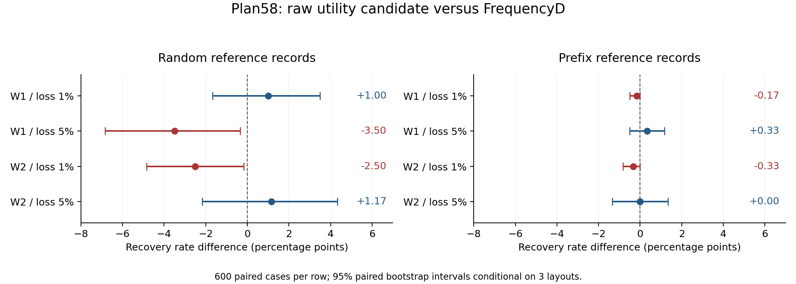

# Plan58：完整记录恢复效用驱动的保护分配——实施与小规模实验报告

日期：2026-10-21。代码及实验在 WSL Ubuntu-22.04 项目 Iot_Audit_MY 中完成。

## 1. 结论与当前决策

**第一版已实现并完成真实恢复实验，但没有证明相比 FrequencyD 的稳定提升。**
保留全部正负结果；继续以原 FrequencyD 为默认；不把本实现写进论文作为“已验证更优”的主创新。

随机参考记录的主实验中，候选四个切片的变化为 +1.00、−3.50、−2.50、+1.17 个百分点。
两窗口、两故障率等权合并时，FrequencyD 为 1258/2400（52.42%），候选为 1235/2400（51.46%），差 −0.96 个百分点。
这个汇总只描述本次混合负载，不替代分窗口/故障率结论，也不是跨数据集显著性结论。

验证规则在 12 个配置中有 11 个回退 FrequencyD；随机参考的 6 个配置全部回退。
前段参考模式唯一选中的候选也未带来测试提升。因此验证选择流程同样没有胜出。

## 2. 实际修改了什么

仅新增 sandbox/route_a_utility_plan58，旧共享代码与旧实验保持原样：

- planner.py：按“全部必需对象最终可获得”计分；联合替换同一失败记录的多个未保护依赖；
  交换条带成员；从 FrequencyD 出发，严格接受训练完整恢复次数增加的候选。
- sidecar.py：把选中的顺序落成真实 RS(10,8) parity 和签名清单。
  两方法使用共同条带数；计入序列化清单、签名、parity 和64 B客户端pin，并检查实际预算。
- run_pilot.py：训练/验证/测试分离、共同故障掩码、真实恢复、独立真值评分、回退决策、原子收据。
- freeze_pilot.py：新建冻结源码和输入包，拒绝覆盖已有实验。
- 两个新测试文件、README、执行记录与后续设计文档。

这不是简单频次重排：12个配置实际接受了290次联合替换和235次条带交换。
它是有限搜索启发式，没有全局最优、次模或近似比保证。训练不下降不保证测试提升。

## 3. 公平性与实验协议

使用 Plan57 已有的两份 SDA-GGD 加密归档，每份 21,600 条记录。
本次重新生成所有策略侧车并实际恢复；不复用旧恢复观测，不测压缩/加密/审计标签构建成本。

| 数据窗口 | 原始密文对象数 | 密文字节 | 共同条带数 | 10%预算 | 两方法实际侧车范围 |
|---|---:|---:|---:|---:|---:|
| train1_2020-07-11 | 419 | 1,712,327 | 20 | 171,232 B | 167,953–167,964 B |
| train2_2020-08-01 | 389 | 1,592,192 | 18 | 159,219 B | 151,171–151,187 B |

这是相同预算上限、相同条带数；页编号改变会导致清单相差数个字节，未声称字节完全相等。

每个窗口分别采用：

- uniform：随机4,096条参考记录，模拟相似请求分布。
- prefix：仅前4,096条记录形成参考依赖，测试后续记录。
- 从参考集合的补集划出1,024条验证目标，其余为测试目标池，三者互斥。
- 每故障率2,048个训练场景；每故障率256个验证场景；80轮、每轮最多8个候选。
- 验证总成功数严格超过 FrequencyD 才选候选，否则回退；原始候选始终单独报告。
- 3个布局种子：61001/61002/61003。训练、验证、测试使用独立的预设种子空间。
- 每窗口×参考模式×布局×故障率运行200个配对案例，另有每配置20个clean案例。
- uniform 和 prefix 的配置均预先固定；正式测试结果出现后没有调参或重选结果。

每个配置先保存其计划和验证决策，再构造该配置测试。不是所有12个计划先统一生成再测试。
prefix 的验证与测试都来自后段；验证选择器不是“不使用任何后段信息”的纯在线预测实验。
压缩表示和归档本身在本轮保持固定，目标切分只用于保护分配评估。

故障在“原始密文对象+parity对象”中均匀不放回抽取固定数量：
窗口1为459对象中的5/23个，窗口2为425对象中的5/22个，对应名义1%/5%。
两方法每案例共用目标和故障掩码；每次恢复重新建缓存，交替运行顺序。

## 4. 真实恢复结果

下表为原始候选，**没有用回退掩盖负结果**。每行600对案例。
差值单位为百分点；赢/输指新方法独自成功/独自失败的配对数。

| 窗口 | 参考模式 | 故障率 | FrequencyD | 原始候选 | 差值 | 配对95%区间 | 赢/输 |
|---|---|---:|---:|---:|---:|---:|---:|
| 窗口1 | uniform | 1% | 76.33% | 77.33% | +1.00 | [-1.67, +3.50] | 34/28 |
| 窗口1 | uniform | 5% | 27.67% | 24.17% | -3.50 | [-6.83, -0.33] | 37/58 |
| 窗口2 | uniform | 1% | 77.17% | 74.67% | -2.50 | [-4.83, -0.17] | 18/33 |
| 窗口2 | uniform | 5% | 28.50% | 29.67% | +1.17 | [-2.17, +4.33] | 51/44 |
| 窗口1 | prefix | 1% | 70.00% | 69.83% | -0.17 | [-0.50, +0.00] | 0/1 |
| 窗口1 | prefix | 5% | 16.67% | 17.00% | +0.33 | [-0.50, +1.17] | 4/2 |
| 窗口2 | prefix | 1% | 66.33% | 66.00% | -0.33 | [-0.83, +0.00] | 0/2 |
| 窗口2 | prefix | 5% | 17.67% | 17.67% | +0.00 | [-1.33, +1.33] | 9/9 |

区间为按布局分层、保留方法配对的4,000次bootstrap，仅条件于本次三个布局和这两份归档。
未进行多重比较校正，不能把个别区间排除零扩张成普遍或跨数据集显著劣势。

验证选择后：uniform四行均与FrequencyD相同；prefix窗口1两行相同；
prefix窗口2两行均低0.17个百分点。零差值来自复用相同FrequencyD观测，不是独立等效性证明。

## 5. 成本、真实性与保全

额外规划耗时中位数为 1.418 秒，范围1.155–1.643秒，包含场景生成、完整优化调用和验证评分。
FrequencyD 排序中位数约0.0285秒；公共依赖图构建中位数约0.346秒，另计。
即使最后回退，优化与验证开销仍然存在，不能记为零。

当前没有稳定收益，因此不能以这些成本支撑新策略优于旧策略。
逐次实际读取原始/parity字节、修复对象数、恢复时间及初始化时间均已保存在CSV；
本轮不据微小本机延迟差异作性能结论。机器没有专用隔离，文件系统缓存未控制。

实验实际执行 ProtectedFetch + recover，通过签名清单、密文哈希和AEAD验证；
成功记录再由独立truth.npy、labels.npy、schema核对全部数值、标签、时间与索引。
恢复函数的数据源只有受故障控制的密文fetch，不使用真值文件补缺。

- 原有安全、调度和队列回归25项通过；新增规划器11项、侧车50项通过。
- 冻结qualification完成144次恢复；收据续跑与未提交产物保留检查通过。
- 正式10,080次调用：故障9,600次；clean480次全部成功；模型与引擎判定零不一致。
- 独立审查从CSV重算所有配对与24个汇总面板，核对目标分离、故障数、侧车预算和签名。
- 130个旧依赖源码/文件、30个复用输入、64,529个旧Plan57结果文件哈希全部不变；
  开始时单独记录的79个核心旧源码也未改变。
- 冻结runtime142个文件、输入30个文件、所有已提交产物校验通过。

本实验只研究静态均匀擦除、单条记录、固定10%预算和RS(10,8)。
不覆盖突发相关故障、异质可靠性、元数据丢失、多记录批请求、跨天泛化、真实网络、持久修复，
也没有测新PDP审计协议。旧安全检查不等于新威胁模型已完成。

## 6. 为什么第一版没有成功

首先是有限故障样本过拟合。uniform配置在抽样训练上的提升为4.44–5.44个百分点，
但6个配置独立验证全部下降，总计少成功79/3072次。

为区分“参考记录不同”和“故障样本不同”，补充了明确标为事后诊断的解析期望计算。
它只评价已经固定的两个uniform/61001方案，不优化、不调参、不产生新方法测试成绩。
固定原来的4,096条参考记录，按同一固定擦除数模型计算：

| 窗口 | 故障率 | FrequencyD期望 | 已有候选期望 | 差值 |
|---|---:|---:|---:|---:|
| 窗口1 | 1% | 78.164% | 76.938% | −1.226 pp |
| 窗口1 | 5% | 28.225% | 26.724% | −1.501 pp |
| 窗口2 | 1% | 77.846% | 76.831% | −1.014 pp |
| 窗口2 | 5% | 29.289% | 28.089% | −1.200 pp |

两种故障率平均后，抽样训练分别增加5.444和4.590个百分点，
而同参考记录的精确期望分别下降1.363和1.107个百分点。
进一步使用原训练案例实际目标频次加权，仍分别下降1.220和0.994个百分点。
因此这两个配置存在清楚的有限故障样本过拟合，不能只解释成训练/测试目标分布差异。
这项诊断不自动证明全部配置都只有同一个原因。

其次，prefix还存在明显覆盖迁移。layout61001中，FrequencyD的未保护必需页数均值，
窗口1从参考记录的0.048增加到测试记录的32.980；窗口2从0.217增加到32.550。
两侧总依赖数变化很小，变化主要涉及依赖页身份。候选未解决这一点。
uniform参考与测试的未保护依赖均值相近，没有同等强度的迁移迹象。

最后，FrequencyD本身是有效基线。低故障率时，平均未保护依赖数控制一阶失败风险；
完整记录目标的额外空间来自高阶联合依赖与条带分组，不能预设一定存在大幅增益。
本轮负结果否定的是这个有限场景启发式已优于FrequencyD的主张，不是否定完整记录效用这一问题定义。

## 7. 下一版建议

优先把有限场景经验计数改为**与故障模型一致的解析期望完整记录效用**，
保留相同候选生成作第一步消融；这样能够直接检验去除故障抽样噪声是否改善泛化。

满条带、统一固定m擦除下，单记录成功概率可用条带有效擦除集合生成函数精确计算。
已完成50组固定m穷举及15组Bernoulli有理数条件核对；
公式、缓存方式、前提及后续验收写在 Plan/plan58/05_next_iteration_proposal.md。
这只是已核对的评分设计和旧方案诊断，**尚未实现/验证采用该目标的新优化器**。

下一轮使用新计划、新输出、新窗口/种子；Plan58测试结果已是开发证据。
继续分开看相似负载与前段到后段迁移，并消融“保护集合”“条带分组”和联合优化。
如果仍只有很小收益，转向依赖闭包感知布局与保护协同，再决定能否成为论文主核心。

## 8. 文件入口与复现

WSL项目根目录：
/home/zsw/codes/Paper/Exp/Iot_Audit_MY

- 实施计划：Plan/plan58/01_implementation.md
- 预注册参数：Plan/plan58/02_protocol.json
- 执行验证：Plan/plan58/03_execution_and_validation.md
- 本报告：Plan/plan58/04_pilot_report.md
- 下一版建议：Plan/plan58/05_next_iteration_proposal.md
- 源码与可复制命令：sandbox/route_a_utility_plan58/README.md
- 冻结包：results/route_a_utility_plan58/pilot_20261021_v1/
- 原始观测：formal/export/observations.csv
- 汇总：formal/export/summary.json、planning_summary.json、validation.json
- 每配置：formal/jobs/.../attempt-0000/plan.json、test_cases.json、sidecars.json、rows.json
- 原文件保全：preservation_before.json、preservation_after.json
- 事后分析：analysis/；不混入正式export。
