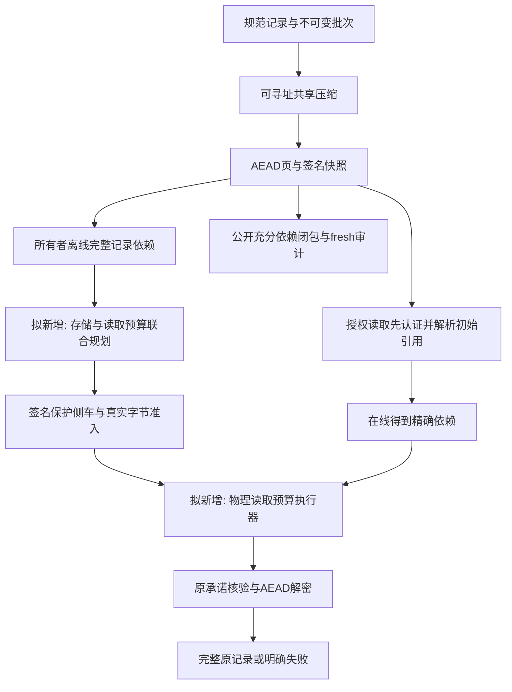

# Plan61：多方案实际筛选、创新归因与完整论文推进方案

日期：2026-10-21。项目：`/home/zsw/codes/Paper/Exp/Iot_Audit_MY`。本报告完成开发筛选和后续设计；主论文尚未改写为新方案，投稿版本尚未完成。旧源码、历史实验和当前主稿保留。

## 1. 应当怎样继续

**推荐主核心调整为：在真实存储与读取预算下，基于完整认证记录依赖的风险约束保护与恢复。** 保留共访问分组作为强工程基线；混合码是可继续研究的辅助选择，parity-first 读取顺序不作为贡献。当前不能把“比 FrequencyD 高很多”直接当作新颖性已经成立。

| 本轮方向 | 结果与判断 |
| --- | --- |
| A：混合几何/覆盖 | 相对18格固定强基线，精确U5提高0.046–1.971个百分点；实际提高0–2.148个百分点，六个单窗区间均跨0。保留辅助分支。 |
| B：依赖分组 | 精确U5提高4.925–6.035个百分点；实际提高1.758–8.789个百分点。但98.824%–100%的精确收益来自原有raw CoAccess/Jaccard，新增局部搜索不能领取全部收益。 |
| A+B：组合 | 精确提高5.270–9.527个百分点，实际提高1.953–12.500个百分点；直接相对B的六个配对区间均跨0，尚不能认定组合优于B。 |
| 读取顺序消融 | eager与lazy成功事件完全一致，成功请求的有效读取字节完全相同；5%名义损失率下各窗lazy全请求字节反增约0.46%–0.64%。保留eager。 |
| 宽码解析对照 | 七种更宽均匀码中的最佳模型U5为93.089%–99.345%，明显高于组合；代价是冷缓存单条带解码需192/224个片。新核心必须公平纳入读取成本。 |

这不是对投稿水平的确认：目前更可靠的成果是一个经过实际核验的系统基础、强基线和明确的问题边界；新的预算联合核心仍需要实现、强对照和未见数据验证。

## 2. 实际实现与实验口径

新增代码独立位于 `sandbox/route_a_utility_plan61/`：异构RS/认证读取器、精确整数评分、连续低损失风险检查、混合码与分组规划、冻结运行器及配对分析。外围审计、宽码模型、raw归因和补充分析位于 `Plan/plan61/`。没有覆盖旧实现。

| 项目 | 本轮设置 |
| --- | --- |
| 数据 | HAI21六个已用过的6小时窗口；每窗21600条、79字段。全部是开发材料，不能称新确认集。 |
| 预算 | 保护侧车不超过基础密文的10%；计入实际规范化清单、签名、pin和parity字节。 |
| 固定码库 | k∈{4,8,12,16,24,32}，r∈{1,2,3}，共18种；每种独立使用真实预算下的native cap。六窗最终都选k=24、r=3，即RS(27,24)。 |
| 八个主实验臂 | FD10、FixedBestRaw、SafeFixedBest、MixedGeometry、DependencyGrouping、Combined、SafeFixedLazy、CombinedLazy。raw固定最优与风险可行固定最优在本轮恰好一致。 |
| 搜索预算 | A、B及组合的每阶段最多64次候选评分；这些是有限启发式搜索，不是全局最优求解。 |
| 主实验样本 | 每窗一个布局seed=64001；0.1%、0.5%、1%各128个配对病例，5%为512个，另8个clean。6×904×8=43392次真实恢复调用，5424个配对病例。 |
| 资格验证 | 480次调用；单独保存，不合并到主实验估计。 |
| 补充raw实际臂 | RawCoAccessSafe和RawCoAccessMixed，冻结布局与既有病例原样复用，新增10848次调用；标记为事后开发归因。 |
| 合计 | 54720次真实调用=43392主实验+10848补充+480资格；它们不是54720个独立样本。 |
| 故障与配对 | 各方案自己的N=n+q，m=ceil(alpha*N)；同一随机排序过滤到自己的总体后取前m，保证均匀固定失效数边际，不能声称不同N使用完全相同mask。 |
| 统计 | 每窗固定布局的保守95%配对Clopper–Pearson区间；没有跨所有方法/窗口的同时覆盖保证。补充对照和预算曲线为探索分析。 |
| 安全状态 | 真实恢复包含签名、可信pin、原承诺哈希与AEAD；当前归档tag=False/audit_ready=False，因此这轮没有完成新方案的公开PDP审计集成。 |

## 3. 主实验：确实有收益，但参照范围必须清楚

下表都是5%名义丢失率、每臂每窗512个病例的**实际完整记录恢复率**，单位%。FD10是原FrequencyD+RS(10,8)；Safe是18格中风险可行的最优固定码。

| 窗口 | FD10 | Safe | A | B | 组合 |
| --- | --- | --- | --- | --- | --- |
| 2020-07-11 | 29.492 | 61.328 | 62.500 | 70.117 | 70.117 |
| 2020-08-01 | 32.812 | 66.992 | 66.992 | 68.750 | 68.945 |
| 2020-07-12 | 22.266 | 64.453 | 65.625 | 70.898 | 70.117 |
| 2020-08-02 | 25.586 | 64.648 | 66.406 | 70.703 | 72.852 |
| 2020-07-13 | 26.953 | 59.961 | 60.938 | 65.430 | 66.797 |
| 2020-08-03 | 21.094 | 56.641 | 58.789 | 64.453 | 69.141 |

相对Safe的实际增量及配对区间，单位为百分点：

| 窗口 | B：增量 [95%区间] | 组合：增量 [95%区间] |
| --- | --- | --- |
| 2020-07-11 | +8.789 [+2.431, +15.008] | +8.789 [+1.703, +15.740] |
| 2020-08-01 | +1.758 [-4.501, +7.989] | +1.953 [-4.524, +8.399] |
| 2020-07-12 | +6.445 [+0.233, +12.554] | +5.664 [-0.905, +12.144] |
| 2020-08-02 | +6.055 [+0.391, +11.618] | +8.203 [+2.228, +14.045] |
| 2020-07-13 | +5.469 [-0.413, +11.261] | +6.836 [+0.333, +13.231] |
| 2020-08-03 | +7.812 [+2.117, +13.379] | +12.500 [+5.848, +18.955] |

B和组合各有4/6个单窗区间下界为正；这仍是已看过窗口上的开发结果，不是跨方法校正后的确认结论。A的六个区间均跨0。组合相对B的直接实际差值为−0.781至+4.688个百分点，六个直接对照区间全部跨0。

图中的最佳固定码只指预先规定的18格。左图为模型期望，右图为实际恢复调用；两者不能混写。

## 4. 关键归因：新增局部搜索没有带来已证实的独立收益

为补齐强基线，本轮进一步对所有六窗的两个冻结raw CoAccess布局实施真实恢复，没有重新选择参数或重跑旧八臂。对照在独立目录保存。下表限定5%名义损失率、每窗512病例，将最终方法减去raw方法，正值才表示局部搜索增加成功率。

| 窗口 | B局部模型增量pp | B局部实际增量 [区间] | 组合局部模型增量pp | 组合局部实际增量 [区间] |
| --- | --- | --- | --- | --- |
| 2020-07-11 | 0.03663 | 0.000 [-0.852, +0.852] | 0.00533 | 0.000 [-0.852, +0.852] |
| 2020-08-01 | 0.04206 | -0.195 [-1.240, +0.850] | 0.04203 | -0.195 [-1.240, +0.850] |
| 2020-07-12 | 0.02458 | +0.586 [-0.759, +1.890] | 0.00488 | -0.195 [-1.574, +1.207] |
| 2020-08-02 | 0.07097 | +0.391 [-1.820, +2.581] | 0.01338 | +0.195 [-1.717, +2.095] |
| 2020-07-13 | 0.00000 | 0.000 [-0.852, +0.852] | 0.06270 | +0.781 [-1.594, +3.121] |
| 2020-08-03 | 0.02403 | -0.195 [-1.240, +0.850] | 0.00000 | 0.000 [-0.852, +0.852] |

十二个final-vs-raw实际区间全部跨0；低丢失率三个采样点中raw与final的成功事件全部相同。B的raw分组贡献其总精确提升的98.824%–100%，组合分组阶段的raw贡献99.022%–100%。因此不能把约5–9个百分点的提升写成“新局部搜索算法”的贡献。

尾部填充对照在六窗均为零模型增量，说明本轮预先规定的append-only策略没有可接受提升；它不能排除覆盖扩展等其他简单机制。A中的风险检查确实拒绝了一些候选，但本轮没有A的无guard对照，不能量化风险约束本身的净性能价值。B与组合搜索中没有出现不满足guard的候选，只能说约束被满足。

## 5. 扩展强基线：宽条带改变了研究问题

在同一预算、同一FD排序上，额外检查了(40,4)、(48,4)、(64,6)、(96,9)、(128,12)、(192,18)、(224,22)七种均匀码，共42个解析布局。使用独立整数生成函数、真实canonical清单成本和全部低alpha断点。以下是每窗风险可行的最佳值。

| 窗口 | k/r | 模型U5 | 相对组合pp | 侧车字节/预算 |
| --- | --- | --- | --- | --- |
| 2020-07-11 | 192/18 | 95.955% | +25.958 | 150,968/171,232 |
| 2020-08-01 | 192/18 | 99.345% | +29.752 | 150,952/159,219 |
| 2020-07-12 | 224/22 | 97.728% | +29.179 | 184,353/194,525 |
| 2020-08-02 | 192/18 | 93.089% | +24.055 | 150,957/181,292 |
| 2020-07-13 | 224/22 | 97.123% | +28.402 | 184,352/193,593 |
| 2020-08-03 | 224/22 | 97.564% | +29.536 | 184,352/192,025 |

这些最优宽码也全部通过相对组合的连续(0,1%]期望风险约束。192/18布局覆盖384页、36个校验对象；224/22覆盖448页、44个校验对象，均为两个条带。

**这42个值全部是解析模型结果，宽码真实编码/恢复尚未资格化。** 同时，常规整片MDS冷缓存重建一个条带需要k个有效片：固定强基线24，组合最大32，宽码192或224。这个阈值不是整条记录平均读取量，更不是实测延迟。不能用k的比值宣称平均字节增加了相同比例。

仅最大化无读取限制的恢复率，宽码已提供强反例；把k≤32当成应用硬约束也缺少依据。下一步必须让宽码在相同服务预算内真实执行，并报告可用性—读取成本的完整曲线。

## 6. 读取证据与淘汰方向

在5%名义损失率下，B与Safe都成功的同一批配对请求中，B平均有效读取字节减少12.42%–15.59%；组合相对Safe减少11.14%–14.28%。但组合相对B的共同成功读取量增加0.54%–3.30%，对应的成功率优势又尚未确认。这支持把B/raw作为更简洁的强工程候选。

parity-first lazy没有增加成功率；同布局的成功请求读取字节与eager完全相同，而5%名义损失率下各窗全部请求字节增加约0.46%–0.64%，额外开销集中在失败情况。本轮不采用lazy作为核心。所有字节均为冻结读取器统计的原页/校验页载荷，不包含完整网络协议开销。不同run的elapsed与并行机器上的计时不作为速度优劣证据。

还对32、64、128、256、512、1024、2048 KiB及无上限完整网格计算了“已成功且实际载荷不超过阈值”的观测比例。该分析显示不同观测载荷阈值下的方法排序不同；没有据此选择有利的单个上限。

图中是网格点上的事后观测比例，连线只辅助阅读。它不是已经实现硬上限执行器后的实验：现有secure_recovery的budget只检查逻辑请求原页，未约束所有helper/parity物理读取；元数据冷启动等也另需计费。

## 7. “低丢失率不退化”目前支持到哪里

A、B和组合相对Safe的风险检查全部通过：对候选/参照各自N的联合ceil断点，在连续alpha∈(0,0.01]上用整数比值比较完整记录成功期望；没有浮点容差放行负值。本轮三个低alpha实际采样点也都未出现负的均值差。

这个结论依赖于均匀固定数量的对象擦除、已认证且可用的元数据、不相交MDS条带和均匀目标记录。它不是每个故障集合都不下降，也不代表设备级相关故障、突发失效、元数据丢失或未见数据。跨N的ceil离散断点本身可能形成严格约束；下一轮还需Bernoulli擦除和相关失效敏感性测试。

## 8. 下一轮真正值得实现的核心

建议把主目标明确为：

$$V_{\alpha,L}(\Pi)=\frac1R\sum_i\Pr[\text{记录 }i\text{ 完整且认证恢复}\;\land\;B_i(\Pi,M)\le L].$$

其中Pi是固定的存储保护布局，B_i是请求的实际读取载荷，L是事先说明的服务预算；侧车存储预算单独约束。比较与风险参照必须使用相同读取额度和工作负载；同时保留无读取限制U作为报告项，不能靠更换指标隐藏下降。多个L下重新优化的布局也不能被说成同一个存储布局能免费逐请求切换。

已经新增二维生成函数推导、两阶段读取论证、真实短页边界及纯理论穷举。它支持把原完整恢复模型扩展为预算内成功模型，仍未构成已完成的新算法、新颖性证明或真实hard-cap实验。详见[理论推导与枚举](ARC_Audit_Plan61_Artifacts_20261021/09_joint_utility_derivation.md)。

| 优先级 | 实施内容 | 验收要求 |
| --- | --- | --- |
| P0：执行语义 | 新增BudgetLedger，统一管理原页、辅助页、parity接收字节、缓存与失败原因；明确元数据冷/热成本。 | 超预算即停止且不返回部分记录；坏块/截断已经收到的字节仍记账；L=∞复现已有行为。 |
| P0：精确评分 | 实现JointUtilityEvaluator：先等长片，再扩展实际长度、短尾页与成本分布。 | 小图全枚举；w求和退回原U；新执行器的逐例成功/预算事件与模型一致。 |
| P1：并行候选S1 | 固定保护集合和码型，以预算内整记录效用生成分组/交换候选。 | 对同几何raw CoAccess做真正增量对照；公开无改进和违反约束的候选。 |
| P1：并行候选S2 | 联合覆盖、码型与分组的有限搜索；考虑宽码与窄码的读取代价。 | 与各自native预算下的强固定/CoAccess码库比较；相同评分预算，报告准备成本与小实例优化差距。 |
| P1：强基线 | 宽RS先完成真实编解码资格化；补强码上的raw CoAccess；需要普遍修复读取主张时加入LRC类对照。 | 所有方法按同存储/读取口径执行。重叠局部码不能沿用不相交MDS评分而不改模型。 |
| P2：完整安全链路 | 相同最终配置上做C1构建、tag生成、公开审计、认证检索和恢复；定义parity是否在审计范围。 | tag-ready集成、完整成本账本、攻击/失败测试、布局信息泄露定义；在线读取不能偷用离线完整D。 |
| P2：稳健证据 | 冻结方法后引入新的未见窗口和独立来源数据；覆盖预算、故障、闭包大小、单/多记录、缓存与网络。 | 开发/选择/确认严格分开；同缓存对照、共同成功与全请求成本；不只展示有利点。 |
| P3：论文同步 | 更新中英文主稿、补充材料、相关工作、安全范围和图表，维护主张—代码—证据矩阵。 | 全部主张能对应最终冻结代码/数据/实验；不把这轮开发结果当最终确认结果。 |

更具体的接口、实施顺序、两个候选分支和失败退出规则见[下一核心实施规格](ARC_Audit_Plan61_Artifacts_20261021/11_next_core_implementation.md)。现成研究已有多对象可用性、共享块保护、压缩编码查询及恢复读取权衡；区别必须落在新的目标、可执行机制和相对于强基线的证据上。[相关工作差距](ARC_Audit_Plan61_Related_Work_Gap_20261021.md)列出原始来源。

## 9. 完整论文流程及当前缺口

下图是拟投稿方案的目标流程；标有“拟新增”的组件尚待实现，已有模块仍需在同一tag-ready配置上集成验证。

C1作为可寻址表示基础，C2作为认证依赖/审计接口，C3承担预算联合核心。当前审计与恢复共享快照，自动“审计失败→定位坏页→修复→再审计”尚未实现；聚合失败本身也不能定位坏页。当前安全论证不应升级成未经证明的新PoR/extractor。依赖驱动的公开侧车会暴露布局/选择信息，需要纳入Leak模型。

完整流程的逐模块代码依据、当前主稿待同步位置、现有与缺失证据见[完整论文流程与证据矩阵](ARC_Audit_Plan61_Full_Paper_Pipeline_20261021.md)。还应加入record/block-oriented表示和同等缓存的批量请求对照，避免仅在固定共享表示和冷单记录条件下得出普遍系统效率结论。

## 10. 验证、保存与复现

80项新增测试与25项原有回归测试通过。独立审计另外重算216个均匀布局、96个最终布局、12个tail模型和613组精确风险比较，核验43872次资格/主实验日志及10968组eager/lazy配对。它没有重新执行这43872次恢复，真实恢复由原运行器完成。

94个输入、163个旧源码文件、768个Plan60历史结果文件和186个冻结文件的哈希保持；最初登记的64个旧源文件和续跑前27个检查点也逐项匹配。raw补充的10848行、CSV/JSONL、预算、oracle、真值、无部分输出、输入源保全均通过。

二维模型的13504个故障集合/171752条模拟路径是纯理论自检，不能加到54720次真实调用中。宽码的42个布局也没有实际恢复调用。

| 产物 | 位置 |
| --- | --- |
| 新实现 | sandbox/route_a_utility_plan61/ |
| 冻结包 | results/route_a_utility_plan61/screening_20261021_v1/runtime/ |
| 主实验与主分析 | screening/export/；analysis_v1/ |
| 宽码解析诊断 | wide_probe_v1/ |
| 真实raw归因 | raw_coaccess_v1/export/ |
| 直接组合对照/共同成功成本/观测预算曲线 | analysis_contrasts_v1/ |
| 独立主审计 | analysis_independent_audit.json |
| 实现与理论后续规格 | Plan/plan61/09_joint_utility_derivation.md；11_next_core_implementation.md |

表中结果子目录均相对本轮结果根目录。原运行入口禁止覆盖既有输出；中断后根据提交receipt恢复。论文当前版本仍承载旧实验定义，不能直接替换数字而不更新方法、配对、风险与成本口径。

