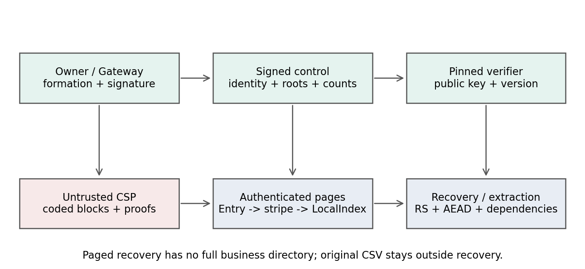
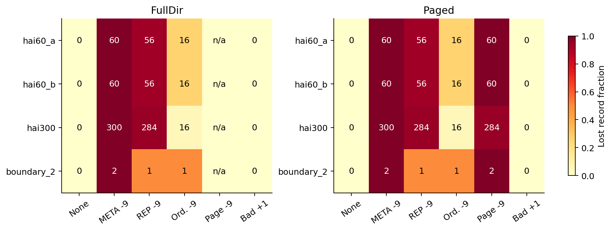
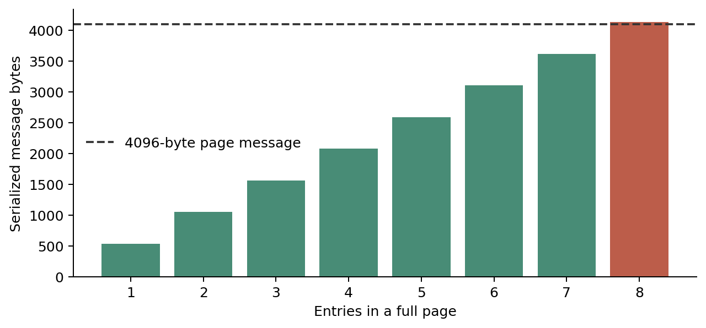
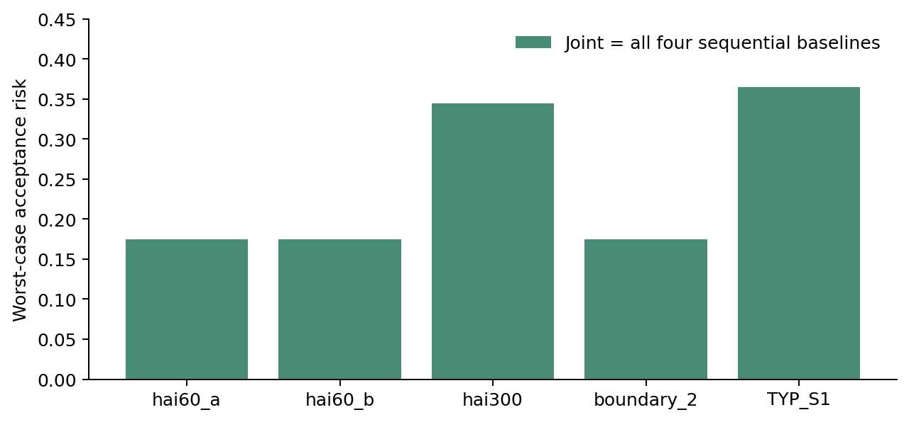
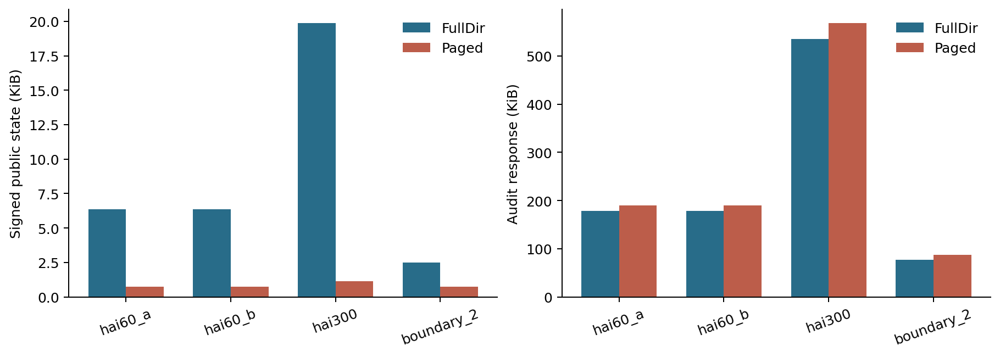
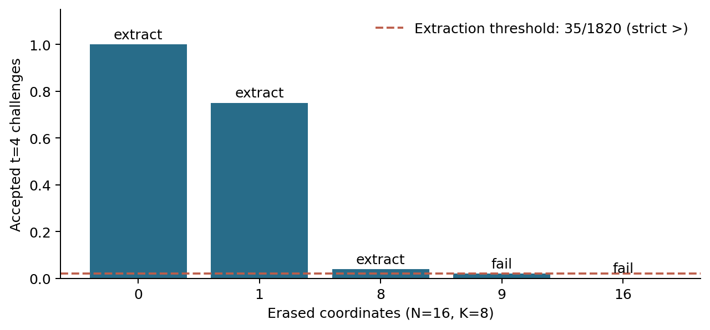

# 相似去重物联网数据的依赖感知审计与认证恢复

**Dependency-Aware Auditing and Authenticated Recovery for Similarity-Deduplicated IoT Data**

中文单栏研究初稿，2026 年 9 月 16 日。正文采用 TDSC 研究论文的论证组织；实现版本为 strict-snapshot-3。

## 摘要

相似去重将物联网记录表示为共享代表、差分和独立回退数据，减少重复表示的同时引入跨记录恢复依赖。云端块挑战的接受率因此不能直接代表业务记录的可恢复比例，目录材料也不能被视为免费的可信输入。本文提出一个连接记录损失、公开审计和认证恢复的评估与实现框架。在固定快照及有限组件故障模型下，定义记录恢复损失和规范路径损失，推导单、双故障的精确审计风险，证明记录闭包抽样与保留代表空抽质量的加权抽样在普通条带上的分布对应，并说明完整目标集合并不等价。实现采用签名控制信息、Reed–Solomon 编码、Merkle 块证明和认证加密，支持无需完整业务目录回退的分页恢复、仅访问证明接口的固定应答提取，以及具有版本检查的快照插入、修改和删除。四个真实数据窗口的 48 个隔离恢复配置均通过字段级正确性核验；分页目录损失会如实传播为记录损失。完整容量候选及五对象比较未发现联合选择优于四种顺序基线。对 9 个块擦除的组件，单轮挑战通过率仍为 35/1820，但无法提取；该结果明确了有限审计接受与恢复保证的区别。实测同时表明，分页显著减少公开状态，却增加冷启动通信，不能只据目录大小判断系统收益。

**索引词：** 物联网数据；相似去重；公开完整性审计；认证恢复；恢复依赖；可提取性

## 1. 引言

工业物联网持续产生具有固定字段和相似数值模式的时序记录。一个运行窗口中的设备标识、状态字段和部分传感器读数可能高度重复，但时间戳、异常读数及数值字符串的具体写法仍具有业务意义。相似去重通过共享代表记录并保存差异，能够利用精确重复检测无法利用的冗余 [1], [2]。这种表示不是简单地减少存储字节：它把原本可独立读取的记录连接为恢复依赖图，使共享材料的失效具有放大效应。

例如，一个代表条带保存一条代表记录，多个普通条带保存依赖该代表的差分。即使普通条带全部完整，只要代表不可解码，这些差分记录也可能无法还原。相反，一个回退条带中的完整记录可以在代表失效后继续恢复。若云端审计只是从所有编码块组成的池中均匀抽样，占总块数很小的关键条带可能长期未被有效检查。此时，较高的审计通过率并不意味着较低的记录恢复损失。去重可靠性研究已揭示共享块的失效放大问题 [3]，但如何将此问题与目录认证、审计预算和可执行恢复联系起来，仍需要具体建模。

第二个困难来自目录。公开审计者需要知道被检查组件的根、编码参数和标识；恢复者还需要知道记录在哪个条带、差分依赖哪个代表。若这些信息取自未认证 JSON，即使每个返回块都通过 Merkle 验证，攻击者也可能通过删除条目、缩小记录分母或替换映射来改变恢复任务。若声称使用分页目录，却在页面失败后读取完整业务目录，则实验实际验证了另一种恢复合同。目录既是认证链的一部分，也是失效传播和成本核算的一部分。

第三个困难是保证层次的混淆。PoR 的可提取性讨论成功应答者能否支持提取算法 [4], [13], [14]，有限轮抽样则只产生一个观察结果。前者必须说明攻击者、提取接口和成功条件，后者必须说明抽样域、擦除方式和轮次。本文将密码学绑定、编码恢复、固定故障检测和预算优化分别定义，然后在同一实现中验证其连接条件。这使正向能力与负结果都能通过明确的实验和定理表达。

### 1.1 研究问题与贡献

本文研究三个问题。RQ1：记录依赖如何影响达到业务损失阈值的故障集合，以及不同目标抽样策略的接受风险？RQ2：认证目录布局如何改变真实恢复行为、公开状态和冷启动成本？RQ3：在明确的应答模型下，什么时候能够从审计接口提取组件，并将该保证组合为记录恢复？

围绕这些问题，本文完成以下工作。

1. 建立记录级依赖模型，区分记录恢复损失与规范路径损失；给出单、双故障风险的精确表达和普通条带抽样分布的条件等价证明。
2. 实现完整签名控制信息、认证条目集合、无完整目录回退的分页解析、逐块证明验证、纠删解码和字段保真恢复。恢复分母由签名承诺固定，部分恢复不会被报告为完整恢复。
3. 实现固定应答预言机提取器及快照更新事务，证明提取阈值和基于外部版本固定的更新安全性质。公开审计接口不需要解密密钥。
4. 提供真实数据隔离恢复、逐事件字节账、包含最大满页容量的候选搜索和多对象对照。报告分页的成本权衡及联合选择的零优势结果，不以选择性案例支持普遍性能优越性。

这里的“精确”指声明故障集合上的有理数计算，以及实际序列化和文件返回字节的逐事件计量。它不表示对任意攻击者、任意布局或真实磁盘扇区成本的全局精确刻画。

### 1.2 论文结构

第 2 节讨论相似去重、共享审计、可靠性与 PoR 的关系。第 3 节定义对象、主体、可信状态和安全游戏。第 4 节给出形成、目录、审计、恢复与更新算法。第 5 节证明绑定、提取和风险性质。第 6 节介绍实现与验证方法，第 7 节报告实验。第 8 节分析适用范围与设计代价，第 9 节总结结论。附录提供证明补充和复现入口。

## 2. 相关工作

### 2.1 相似去重与安全表示

Gao 等面向 IIoT 数据构造相似性保持标签和相似性拥有证明，将相似比较部署到边缘节点，并研究密文去重及其通信代价 [1]。FuzzyDedup 则研究近重复数据的安全去重，结合模糊提取器和相似性保持机制处理传统精确相等判定之外的冗余 [2]。这两项工作为相似数据安全处理提供了直接背景，但其研究目标与本文不同：本文输入是形成后的代表、差分和回退结构，关心这些表示在材料失效时能否恢复为原始业务字段。

BL-MLE 研究大文件的块级消息锁定加密，同时支持去重所需的密钥与证明机制 [7]。本文使用独立 Owner 密钥和 AES-GCM，不声称实现跨用户消息锁定加密，也不将加密后的随机密文相等性用作去重判据。相似性分析发生在授权形成端，云端保存形成后的密文。这一选择便于隔离恢复依赖问题，但不能直接获得跨用户去重收益或所有权隐私保证。

### 2.2 去重可靠性与共享审计

PFP 通过逐文件冗余增强去重存储的可靠性，指出关键共享块丢失可能同时影响多个引用文件 [3]。本文沿用“引用关系决定损失放大”的观察，但将粒度改为结构化记录，并把代表、META 和目录页纳入依赖图。冗余编码回答材料如何恢复；审计策略回答在预算内多大概率发现材料不足。两者不能相互替代，也不能通过只测无故障恢复来判断整体可靠性。

Tian 等研究去中心化存储中的安全去重和共享审计，使用双服务器及区块链机制减少重复工作 [8]。Miao 等进一步关注共享数据的认证标签和密钥冗余问题 [9]。Zhang 等分别讨论区块链存储的安全去重审计 [10]，以及去重过程中的所有权隐私保护 [11]。这些研究说明共享审计能节省认证开销，同时也涉及用户、密钥、标签和存储主体之间的关联。本文不复现其链上协议，而是研究另一条关联：一个认证材料失效会影响多少可恢复记录。

Pan 等针对动态云数据设计混合审计和 Merkle 更新机制 [12]。与该类局部动态更新相比，本文的更新实现采用完整快照重形成，代价随对象规模增长。选择这一实现是为了获得容易核验的版本隔离和失败原子性，而不是提出更高效的动态 PoR。本文实验据实记录重写字节，不能将固定大小的 head 更新当成完整更新成本。

### 2.3 可取回性与可提取性

Juels 和 Kaliski 将 PoR 定义为通过紧凑证明检验远程数据可取回性的机制 [13]。Shacham 和 Waters 给出具有正式安全分析的紧凑 PoR 构造 [14]。这类工作中的提取器、成功应答条件和编码假设构成保证的核心，不能被若干次审计成功替代。Wang 和 Hong 的多文件 PoR 研究一次验证多个文件，并明确限定其可提取性所适用的安全条件 [4]。因此，本文比较的是保证的前提与对象粒度，而不是把其证明性能数字直接搬入不同存储后端。

Shi、Silver 和 Mu 提出增量去中心化归档定义与构造，研究异构节点的空间贡献、数据恢复及组合问题 [5]。Yang 等将去重、可取回性和区块链结合，面向云存储构造相应机制 [6]。这些系统比本文的固定坐标应答模型具有不同的状态、参与方和激励结构。本文只给出一个明确受限但可执行的提取定理：当每个坐标的应答能力固定，且成功率超过组合阈值时，认证坐标足以纠删解码。本文没有由该定理推出去中心化空间承诺或任意自适应应答者的 PoR。

### 2.4 比较与定位

表 1 比较研究问题和保证边界。“侧重点不同”表示本文没有找到可直接复用的同合同评估结论，不表示相关工作从未讨论该方向。

| 研究线 | 代表工作 | 主要对象与保证 | 本文的对应处理 |
|---|---|---|---|
| 相似/模糊安全去重 | [1], [2] | 近重复识别、拥有证明、密文表示 | 将形成后依赖作为输入，检验字段恢复 |
| 共享块可靠性 | [3] | 去重共享引用与冗余恢复 | 记录级损失与代表失效传播 |
| MLE 与大文件去重 | [7] | 数据相关密钥和块级去重 | 授权端形成、独立 Owner 密钥 |
| 共享与隐私审计 | [8]–[11] | 标签、密钥、所有权和链上机制 | 认证目录和实际材料计量 |
| 动态审计 | [12] | 局部更新与混合审计 | 完整快照事务及版本检查 |
| PoR 与多文件 PoR | [4], [13], [14] | 成功应答与提取算法 | 固定应答集合的有限提取器 |
| 增量归档和去重 PoR | [5], [6] | 组合保证与系统构造 | 明确区分组件、记录与系统保证 |

表 1：相关工作定位。本文不以一个统一的“支持/不支持”标签替代不同威胁模型的比较。

本文的主要价值是把恢复依赖、目录认证和审计观察放进同一可复核流程，并揭示在该流程下成立或不成立的推论。所用签名、哈希、纠删编码和认证加密均为已有技术；新原语安全性不是本文主张。

## 3. 系统模型与问题定义

### 3.1 记录、对象与依赖

一个对象包含有限记录集合 \(\mathcal X=\{x_1,\ldots,x_n\}\)，每条记录是具有固定字段顺序的字符串向量。对象内共享的字段形成 FRAME 模板，变化字段构成载荷。选择一条代表记录 REP，其余记录使用相对代表的差分 DELTA 或完整载荷 FALLBACK。回退条件包括无压缩净收益和形成规则要求保留原值的情况。本文以字符串相等作为恢复正确性标准，因而 1、1.0、00123、科学计数法和空字段不被无条件合并。

载荷按照类型分离装入业务条带。以 \(R\) 表示代表条带，\(G_D\) 和 \(G_F\) 表示差分和回退条带集合，\(M\) 表示 META。META 保存恢复所需的 FRAME 与字段位置。令 \(g(x)\) 为记录所在业务条带，\(P(g)\) 为承载该条带 Entry 的目录页；FullDir 中没有编码目录页。业务组件依赖为

\[
\operatorname{dep}(x)=
\begin{cases}
\{M,R\},&x\text{ 为 REP},\\
\{M,R,g(x)\},&x\text{ 为 DELTA},\\
\{M,g(x)\},&x\text{ 为 FALLBACK}.
\end{cases}
\tag{1}
\]

Paged 的实际依赖还包括取得相应 Entry 所需的页；DELTA 同时需要能够发现代表 Entry。控制信息提供可信入口，但不包含可替代页中业务条目的完整映射。每个条带的 LocalIndex 保存记录标识、密文区间、类型、版本和依赖上下文，只有在条带通过认证后才解析。图 1 展示这些数据与信任关系。

图 1：签名控制信息连接目录、编码组件和记录恢复。Owner/Gateway 属于可信形成端；CSP 的目录和组件均需验证。分页恢复不接收完整业务目录。

### 3.2 主体、可信状态与接口

系统包括数据所有者 Owner、形成并签名的 Gateway、云存储服务 CSP、公开审计者 Auditor 和授权恢复者 Recovery。实验中 Owner 与 Gateway 由同一受控形成环境承载，但加密密钥与签名密钥分离。CSP 只保存编码密文、目录页和公开证明材料；Auditor 只读取公开状态和块证明，不获得 Owner 解密密钥。

验证者通过带外渠道固定 Gateway 公钥，并由调用方提供预期对象标识、快照标识和数据版本。签名本身只能证明“被该密钥签过”，不能证明“这是最新版本”。因此，版本固定是协议输入，而不是从待验证文件中自取的字段。Recovery 额外获得对应快照的 Owner 密钥；源 CSV、故障前明文索引、形成缓存、其他布局副本及 Gateway 私钥不属于恢复接口。

原型提供五类接口：形成并发布快照、公开审计、授权恢复、固定应答提取和快照更新。恢复输出包含成功记录、失败原因、承诺记录总数及未恢复数量。公开审计与恢复都是读取协议；更新仅由授权 Owner 执行，不能由 CSP 重新签名数据。独立核验器位于恢复进程之外，只比较恢复输出与原始字段，不向恢复者提供缺失值。

### 3.3 故障与损失指标

令 \(D\) 表示失效材料集合。组件失效在模型中表示该组件无法提供足够的合法编码块；物理实验通过删除指定坐标或破坏返回块实现。定义

\[
L_{\rm rec}(D)=n-\left|\{x\in\mathcal X:\operatorname{Recover}(D)\text{ 正确输出 }x\}\right|,
\tag{2}
\]

\[
L_{\rm path}(D)=\left|\{x\in\mathcal X:\operatorname{path}(x)\cap D\ne\varnothing\}\right|.
\tag{3}
\]

\(L_{\rm rec}\) 是执行结果，需要真实解码、认证和字段比较；\(L_{\rm path}\) 是声明依赖路径被破坏的记录数。存在备用认证路径时，两者可以不同。本文 v3 的 Paged 不提供完整目录回退，因此页损失会成为真实访问障碍；历史带回退原型的路径损失仍可用作模型对照，但不能代替 v3 的恢复结果。

预算模型将故障域限制为至多两个抽象组件。给定损失阈值 \(\lambda\)，定义危险故障集合

\[
\mathcal F_\lambda=\{D\subseteq V:1\le |D|\le 2,\ L_{\rm rec}^{\rm model}(D)\ge\lambda n\}.
\tag{4}
\]

此处使用上标 model，强调 E2/E4 的损失由冻结的抽象依赖合同计算。物理页集合与抽象页节点并不自动一一对应；第 7 节单独报告执行版 Paged 的损失。只有故障映射和恢复合同完全一致时，才可把实测损失代入同一风险式。

### 3.4 攻击者与安全目标

攻击者控制 CSP 的文件、目录和返回值，可删除、替换、重复和重排材料，可提交其他快照的旧数据，可伪造证明路径或将错误块放在合法坐标。攻击者知道算法、公开状态和审计请求。形成端、公钥固定过程、Owner 密钥和调用方期望版本可信；主机内核、签名库及密码原语的实现错误不在形式化攻击者模型内。

绑定游戏要求攻击者使验证者接受与诚实发布快照不同的控制信息或组件内容。恢复正确性游戏要求攻击者使 Recovery 输出一个不属于该快照的记录，或把不完整恢复报告为完整恢复。新鲜性游戏固定调用方预期身份三元组，要求攻击者用不同三元组的旧签名材料通过验证。可用性不是无条件保证：攻击者可以删除所有材料，正确行为是报告无法恢复。

提取性单独采用固定应答模型。对每个组件，存在挑战前固定的可认证坐标集合 \(S\)；查询 \(i\in S\) 返回该坐标的合法块及证明，否则失败。应答者可保留 Merkle 内部节点，但不能临时改变哪些坐标可应答。该限制匹配固定擦除实验，不覆盖根据查询历史调整状态的任意多项式时间应答者。模型中的均匀随机挑战与实现中的公开预登记实验种子也需区分：实验种子用于复现；部署时应由验证者在故障固定后产生新随机种子。

本文不主张隐藏记录数量、类型、目录大小或访问模式。公开 META 中的共享字段可能暴露业务信息；因此本文的保密性只限于所用 AEAD 的载荷保护条件，不给出整个数据集的语义安全定理。该泄漏应在部署前作为配置和威胁评估的一部分。

### 3.5 符号与优化目标

表 2 给出主要符号。所有计量单位采用字节；记录数、块数和页数不混用。

| 符号 | 含义 |
|---|---|
| \(n,\mu_g\) | 对象记录数、普通条带记录数 |
| \(N,K\) | 组件编码块数、恢复阈值 |
| \(r,t_v\) | 记录/条带目标抽样次数、组件内块挑战数 |
| \(b,a,d\) | 每页条目容量、Entry 字节、模型 PageDesc 字节 |
| \(P_v,P_{uv}\) | 目标包含单组件或组件对的概率 |
| \(\alpha_v\) | 组件被选中后检测固定擦除的概率 |
| \(\mathcal F_\lambda\) | 达到记录损失阈值的有限故障集合 |
| \(R(c)\) | 配置 \(c\) 在该集合上的最坏接受风险 |
| \(B_{\rm io},B_{\rm net},B_{\rm pub}\) | 读取、通信和公开状态预算 |

给定明确候选域 \(\mathcal C\)，优化问题为

\[
\min_{c\in\mathcal C}R(c),\qquad
R(c)=\max_{D\in\mathcal F_\lambda}\Pr[\operatorname{Audit}(c,D)=1],
\quad C_j(c)\le B_j\ \ (\forall j).
\tag{5}
\]

不同成本函数定义不同的可行集。本文保留历史解析成本模型以进行策略比较，同时提供独立的 v3 实际计量。二者的候选最优值不能在未重新校准的情况下互相代用。

## 4. 方案设计

### 4.1 保真形成与组件编码

形成端先提取所有记录共享的 FRAME 字段，再选择代表记录，并对每条剩余记录比较差分与完整载荷长度。差分必须保留恢复到原始字符串所需的信息，不能仅保存浮点运算结果。形成结束前执行本地往返检查，确保每条恢复向量与输入逐字段一致。类型为 REP、DELTA 和 FALLBACK 的记录分别装箱，防止解码规则依赖未经认证的外部分类。

每个业务条带编码前的布局为

\[
\operatorname{Msg}_g=\operatorname{Header}_g\Vert
\operatorname{LocalIndex}_g\Vert
\operatorname{Ciphertexts}_g\Vert 0^{p_g},
\qquad |\operatorname{Msg}_g|=24576.
\tag{6}
\]

Header 为 462 B，RecordBinding 为 446 B。形成端要求头、索引、密文及填充的长度和严格等于消息容量；载荷预算 16384 B 只是装箱限额，不等于编码前总消息长度。每条 RecordBinding 绑定 sid、类型、密钥时期、加密版本、gid、偏移、长度、密文哈希和依赖上下文。恢复端检查连续区间、边界和标识重复，避免一个条带内部出现覆盖或遗漏。

业务条带和 META 使用 RS(16,8)，每个编码块为 3072 B；页消息使用相同编码参数，每块为 512 B。因此每个业务组件实际码字为 49152 B，页码字为 8192 B。Merkle 叶绑定坐标与块内容，组件根由公开认证链固定。返回块先验证 opening，再作为合法坐标参与解码；错误块被视为不可用坐标，而不是不加验证地交给纠删解码器。

### 4.2 加密与依赖上下文

Owner 使用 HKDF-SHA256 分离对象和记录密钥，采用 AES-256-GCM 保护载荷。抽象写为

\[
K_{\tau}=\operatorname{HKDF}(K_{\rm owner},\tau,\operatorname{fid},\operatorname{epoch}),
\quad K_x=\operatorname{HKDF}(K_\tau,\operatorname{sid}_x),
\tag{7}
\]

\[
C_x=\operatorname{AEAD.Enc}_{K_x}(\nu_x,m_x;AD_x),
\quad
AD_x=\operatorname{canon}(\operatorname{fid},\tau,\operatorname{epoch},
\operatorname{sid}_x,\operatorname{encver}_x,\operatorname{type}_x,\operatorname{depctx}_x).
\tag{8}
\]

差分的依赖上下文绑定代表标识及代表密文承诺：

\[
\operatorname{depctx}_x=
H(\operatorname{canon}(\text{DEPCTX},\operatorname{sid}_R,
H(\operatorname{canon}(\text{PAYLOAD},R,\operatorname{encver}_R,C_R)))).
\tag{9}
\]

REP 和 FALLBACK 使用域分离的规范空上下文。这样，即使攻击者能把另一份合法代表数据放到可读路径，也不能使当前差分在未匹配的代表上下文下被接受。组件根验证已经绑定密文字节；AEAD 则在解密时进一步验证记录上下文，并拒绝错误 Owner 密钥。

v3 每次发布尝试生成新的随机 Owner 主密钥，并将密钥时期与数据版本绑定。形成期间每个记录密钥的 nonce 从持久计数器预留；失败尝试的临时材料不被重用。不同更新尝试即使具有相同候选版本，也因重新取样主密钥而分离加密空间。此处的随机密钥更新具有管理成本，不能据此宣称具备多用户密钥分发或撤销功能。

### 4.3 完整控制信息与目录

签名对象包含协议版本、对象/快照/数据版本、RS 参数、Owner 密钥时期、记录总数、业务 Entry 总数、META 根、业务 Entry 集合根和布局材料。控制信息使用确定性 JSON 编码后放入域分离的规范签名消息：

\[
\sigma=\operatorname{Sign}_{sk_G}
\bigl(\operatorname{canon}(\text{STRICT3},\operatorname{Encode}(C))\bigr).
\tag{10}
\]

FullDir 在 \(C\) 中携带完整 Entry 规范字节序列。恢复者验证签名、条目数量及 Entry 根后使用该序列。Paged 在 \(C\) 中只携带有序 PageDesc 列表，每个描述符包含页名字、条目数量、页组件根和页内 Entry 根；完整 Entry 与记录映射不出现于控制信息。Entry 中的 gid 直接导出组件路径，不需要另一个 gid 到文件名的未认证映射。

令 \(E_1,\ldots,E_m\) 为有序业务条目，页 \(j\) 包含连续子序列 \(I_j\)。认证关系为

\[
\rho_E=\operatorname{MerkleRoot}(E_1,\ldots,E_m),\qquad
\rho_{E,j}=\operatorname{MerkleRoot}((E_i)_{i\in I_j}),
\tag{11}
\]

\[
\operatorname{VerifySig}(C,\sigma)\Rightarrow
\rho_{P_j}\Rightarrow\operatorname{PageBytes}_j
\Rightarrow\rho_{E,j}\Rightarrow E_i\Rightarrow\rho_{g_i}.
\tag{12}
\]

PageDesc 的顺序和计数由签名固定。所有页可读时，验证者还重算全局 Entry 根；某页不可恢复时，仍可使用其他认证页中的 Entry，但必须保留承诺的记录分母。页缺失不触发完整目录回退，也不使不可访问条目被默认为不存在。目录集合的“完整性”因此分成认证完整性与可用性：前者由签名和哈希链保证，后者通过明确的未恢复数量反映。

Entry 长度为 493 B，页容器及字段开销满足

\[
S_{\rm page}(k)=20+k(21+493)=20+514k,\qquad
b_{\max}=\left\lfloor\frac{4096-20}{514}\right\rfloor=7.
\tag{13}
\]

因此满页 7 项为 3618 B，8 项为 4132 B，后者超容量。对不足 7 个条目的对象，较大的名义 \(b\) 可以产生相同的单页表示；完整候选搜索应区分实际布局与参数别名。本文使用 \(b=1,\ldots,7\) 覆盖所有满页容量，小对象的等价参数保留用于同域比较。

### 4.4 公开审计

Auditor 首先验证固定公钥及预期身份下的控制信息。FullDir 直接解析认证 Entry；Paged 在冷启动时通过组件提取接口获取各目录页，并核验页内与全局 Entry 集合。随后对指定业务组件及 META 生成块坐标，查询 CSP 并验证 opening。公开审计不调用 Owner 解密接口；它证明所查询块与承诺一致，而不公开恢复每条业务记录。

为避免不同组件的挑战相关，种子按快照和组件域分离：

\[
s_v=H(\operatorname{canon}(\text{AUDIT3},s,\operatorname{snapshot},v)),
\qquad Q_v\leftarrow\operatorname{SampleNoReplacement}(s_v,t_v,N).
\tag{14}
\]

拒绝采样消除简单取模产生的偏差。理论分析假设每轮种子新鲜、独立且在固定擦除后生成；实验使用预先登记种子以便逐点复现，不把确定性实验种子本身当成不可预测随机源。

**算法 1：公开冷启动审计。**

1. 验证控制信息的签名、协议类型、对象、快照和数据版本。
2. 解析 FullDir，或逐页提取并认证 Paged；目录不可取得则返回拒绝。
3. 根据目标策略生成去重后的组件集合，并为每个组件生成挑战坐标。
4. 通过同一请求接口取得块及 opening，验证坐标、长度、叶哈希、路径和组件根。
5. 返回全部挑战的合取结果及完整事件账。

v3 的实测公开接口采用“全部业务组件加 META”的固定覆盖基线，每组件挑战 4 块；其目录页冷启动使用至少 8 个合法块提取。第 5 节的五种目标策略由独立精确模型比较。本文不把该固定覆盖接口的实测成本冒充每一种抽样策略的运行成本。

### 4.5 授权恢复与组件提取

Recovery 从签名控制信息开始，先提取并认证 META，再解析目录，按照 REP 优先的顺序处理业务条带。每个组件的提取器只通过请求接口访问坐标，不读取完整块列表、原始数据或另一份无故障存储。它依次查询尚未处理的坐标，保留验证成功的不同坐标，获得 \(K\) 个后执行 RS 解码，并重编码核对组件根。

**算法 2：固定应答组件提取。** 输入组件标识、可信根、\(N,K\) 和块长度。初始化合法坐标集合为空；依次请求 \(0,\ldots,N-1\)，丢弃缺失和认证失败的响应；达到 \(K\) 个坐标时解码并重算根，成功则输出消息；穷尽坐标仍不足 \(K\) 则输出失败。算法最多查询 \(N\) 次，不把重复返回同一坐标计作新的独立材料。

**算法 3：认证记录恢复。** 验证控制信息和授权密钥时期；认证 META 与可取得的目录页；从 Entry 取得组件根；调用算法 2；检查 Header、LocalIndex、区间和 sid 唯一性；核对密文承诺；验证差分的代表上下文；执行 AEAD 解密与字段重建；返回正确记录和相对于签名记录总数的未恢复数量。

恢复者不会因为某条普通条带缺失而停止处理所有回退条带。代表不可恢复时，DELTA 失败，但 FALLBACK 仍可恢复；META 不可恢复时，没有足够材料解释 FRAME，因而不输出记录。错误 opening 可由其他合法坐标绕过，此时应记录认证失败坐标，同时仍允许整个组件恢复成功。这体现了数据认证与纠删容错的不同职责。

### 4.6 快照更新与发布

更新支持插入、替换和删除已有记录。Owner 在独占写入锁下读取当前版本，并执行比较交换检查：只有当前版本等于调用方期望版本时才继续。操作先作用于 Owner 保存的记录集合；随后完整重形成对象，分配随机快照标识和新密钥，写入独立目录，最后原子替换 head。读者使用固定快照路径，不会在一次恢复中混合新旧组件。

**算法 4：更新事务。** 获取对象写入锁；检查当前版本与预期值；验证插入不重复、替换与删除对象存在；生成新记录集合；形成并签署新快照；完成新目录写入；以原子重命名发布新 head；释放锁。发布前失败保留旧 head，未发布目录不成为读者默认入口。本文对象形成要求至少两条记录，删除到更小集合时应由调用方使用对象删除接口或拒绝该操作；原型选择拒绝。

公开签名控制信息保证版本间内容不可拼接；外部固定版本负责拒绝旧签名快照。Owner 的本地 head 不等价于分布式共识，无法单独抵抗可信主机整体回滚。完整重形成的更新成本为线性，历史目录可供固定版本读者继续访问；垃圾回收、密钥撤销和跨节点发布属于独立系统问题。

## 5. 理论与安全分析

### 5.1 认证链与恢复正确性

**定理 1（快照内容绑定）。** 假设 Gateway 诚实形成快照，签名满足 EUF-CMA 安全性，Merkle 使用抗碰撞哈希，验证者固定正确公钥及预期身份三元组。攻击者使 v3 接受不同控制信息，或使已认证组件解码为不同消息的优势，至多为签名伪造优势与多项式次哈希碰撞优势之和：

\[
\operatorname{Adv}_{\rm bind}(\mathcal A)
\le \operatorname{Adv}_{\rm sig}(\mathcal B_1)
+q_H\operatorname{Adv}_{H}^{\rm cr}(\mathcal B_2).
\tag{15}
\]

其中 \(q_H\) 吸收多组件、多路径归约的多项式损失，不给出未经原语分析支持的数值安全位数。

**证明。** 将攻击分为控制信息改变与控制信息不变两类。若规范控制字节改变且签名仍通过，得到新消息签名伪造。若控制信息不变，FullDir 的完整条目字节已被签名固定；Paged 的页根、页内 Entry 根、顺序和计数被固定。不同页消息或不同 Entry 集合若通过同一根验证，可在两棵认证树的第一处分歧归约出哈希碰撞。业务组件根因此也固定。若算法 2 输出不同消息，其重编码码字具有相同 Merkle 根；由于诚实形成使用确定性 RS 编码，不同消息导致不同码字，再次得到碰撞。对所有调用取并合界即得式 (15)。证明允许材料缺失导致失败，不把可用性从签名安全性中推出。证毕。

**推论 1（无错误记录与固定分母）。** 在定理 1 的条件下，若 Owner 密钥正确、字段编码往返正确，且恢复端执行 LocalIndex、依赖上下文和 AEAD 验证，则输出记录属于承诺快照；未恢复数为签名记录总数减去成功的不同记录数。错误密钥或密文替换若通过 AEAD，额外计入其认证伪造优势。

证明中，META、记录绑定和密文都来自已认证消息；依赖上下文固定了 DELTA 使用的代表密文。确定性字段解码只能输出对应的原向量。sid 去重阻止重复计数，签名总数阻止缩小分母。部分页不可读只会减少可发现条目，不会改变承诺总数。需要强调，字段保真属于实现正确性前提，本文通过独立字段比较和边界输入测试支持该前提，而不是把它归约到哈希安全性。

### 5.2 固定应答模型的可提取性

令 \(s=|S|\)。在 \(t\) 个不同坐标均匀挑战且必须全部应答的规则下，

\[
p_s=\frac{\binom{s}{t}}{\binom Nt},
\qquad \binom{s}{t}=0\quad(s<t).
\tag{16}
\]

**定理 2（有限固定应答提取）。** 对诚实编码组件、固定合法坐标应答模型以及 \(1\le t\le K\le N\)，若

\[
p_s>\frac{\binom{K-1}{t}}{\binom Nt},
\tag{17}
\]

则算法 2 在至多 \(N\) 次坐标请求后取得该组件原消息，除非出现认证绑定失败。

**证明。** 若 \(s\le K-1\)，组合数的单调性给出 \(p_s\le\binom{K-1}{t}/\binom Nt\)，与式 (17) 矛盾，故 \(s\ge K\)。顺序查询每个坐标至多一次必定取得 \(K\) 个合法不同坐标。RS 的 MDS 性质使任意 \(K\) 个合法块唯一确定消息；重编码根检查确认其与原承诺相同。算法可在第 \(K\) 个合法坐标处提前结束，但最坏请求上界仍为 \(N\)。证毕。

严格不等号不可删除。RS(16,8)、\(t=4\) 时阈值为

\[
p_{\rm th}=\frac{\binom74}{\binom{16}4}
=\frac{35}{1820}=\frac1{52}.
\tag{18}
\]

仅保留 7 个合法块的应答者恰好达到阈值，仍不足以解码。保留 8 块时单轮通过率为 \(70/1820=1/26\)，算法能够恢复。定理讨论真实成功概率及固定接口，不表示观察一轮成功即可推断式 (17)。统计估计需另给样本数、置信度和固定模型适用性。

**推论 2（依赖闭包恢复）。** 若一条记录所需的 META、目录页、业务条带，以及其可能依赖的代表条带都满足算法 2 的提取条件，且授权密钥可用，则该记录可恢复。对全对象应用该条件，得到所有记录恢复。若只对池化平均成功率给出下界，却未保证每个必要组件达到阈值，则不能使用该推论。

该结果是结构简单的固定应答提取保证。任意状态化应答者可能对不同查询历史提供不同材料，其成功概率不能写成式 (16)；对这类应答者需要更强的 PoR 安全定义与提取技术 [14]。

### 5.3 抽样分布与单、双故障风险

模型比较五种目标策略：记录闭包抽样、均匀业务条带抽样、固定关键组件加均匀普通条带、固定关键组件加记录质量加权普通条带、以及仅在普通记录质量上归一化的加权抽样。固定关键组件策略强制覆盖代表、META 和抽象页节点；记录闭包策略则根据所选记录派生依赖。

普通条带 \(g\) 包含 \(\mu_g\) 条记录。记录闭包执行 \(r\) 次有放回均匀抽记录，故

\[
P_g=1-\left(1-\frac{\mu_g}{n}\right)^r.
\tag{19}
\]

**命题 1（普通条带分布对应）。** 将每次记录抽样映射为普通条带标签；代表记录映射为空标签。按 \(\mu_g/n\) 抽普通条带并保留代表空抽质量的加权策略，与记录闭包产生相同的普通条带目标集合分布。

**证明。** 两个过程每次产生标签 \(g\) 的概率均为 \(\mu_g/n\)，产生空标签的概率均为 \(n_{\rm rep}/n\)。将其使用同一串独立标签耦合，取 \(r\) 次出现标签的集合即可逐样本对应。该耦合没有指定关键组件的覆盖方式，故不能推出完整目标集合分布相同。证毕。

若在普通记录上重新归一化，概率变为 \(\mu_g/(n-n_{\rm rep})\)，空抽被移除，已不属于同一分布。完整目标集合也存在直接反例：TYP_S1 在 \(r=1\) 时，记录闭包的代表/页覆盖概率为 \(215/232\)，强制关键策略为 1。因此，实测最优风险相等与“所有证明数分布完全相等”是不同命题。

对固定擦除 \(e_v\)，组件内不放回均匀抽取 \(t_v\) 块，检测概率为

\[
\alpha_v=1-\frac{\binom{N-e_v}{t_v}}{\binom N{t_v}}.
\tag{20}
\]

令目标包含事件为 \(I_v\)，条件检测事件为 \(J_v\)。假设不同组件检测随机性在给定目标后独立，并与目标抽样独立。对单、双故障有

\[
R_{\{u\}}(c)=1-\alpha_uP_u,
\tag{21}
\]

\[
R_{\{u,v\}}(c)
=1-\alpha_uP_u-\alpha_vP_v+\alpha_u\alpha_vP_{uv}.
\tag{22}
\]

**定理 3（有限故障风险）。** 在上述条件下，式 (5) 的最坏风险等于对 \(\mathcal F_\lambda\) 中各单、双故障使用式 (21)、(22) 后取最大值。

**证明。** 审计拒绝事件为至少一个失效组件同时被选中且被检测，即 \(\bigcup_{v\in D}(I_v\cap J_v)\)。当 \(|D|\le2\) 时对该并集展开容斥，利用条件独立性得到式 (21)、(22)，然后对危险故障集取最大值。约束的是失效组件集合大小，不是审计目标集合大小；一轮审计仍可检查很多健康组件。证毕。

### 5.4 成本、容量与有限优化

模型成本分为组件挑战账和目录相关增量，候选布局与审计参数必须使用相同的 \(r\)。v3 的实际计量则直接记录每次文件返回和请求/响应序列化事件：

\[
C_{\rm read}=\sum_{\ell\in\mathcal E_{\rm read}}|\operatorname{returned}_\ell|,
\quad
C_{\rm net}=\sum_{q\in\mathcal E_{\rm req}}|q|
+\sum_{a\in\mathcal E_{\rm resp}}|a|,
\tag{23}
\]

\[
C_{\rm public}=|\operatorname{Encode}(C,\sigma)|,\qquad
C_{\rm publish}=\sum_{f\in\mathcal E_{\rm output}}|\operatorname{written}_f|.
\tag{24}
\]

读取账包括控制文件、块和证明文件，恢复时还包括授权密钥文件；公开审计没有该密钥项。控制文件在本地入口读取，若部署时经网络分发，应额外把其分发字节加入网络账。当前接口用十六进制 JSON 表示块与哈希，通信长度包含该表示开销。缓存未启用，所以不将任何读取标为免费缓存命中。式 (24) 的发布量覆盖最终 v3 包，形成端临时 v2 工作区、文件系统元数据和实际物理磁盘写放大另属系统成本。

**命题 2（声明域上的最优）。** 对有限候选集合 \(\mathcal C\)，逐候选计算同一风险函数、按相同预算过滤并选最小值，得到该集合可行子集中的最优解。该命题来自有限集合最小值定义，不能推出候选域之外的最优性。

本文为布局比较使用 FullDir 与 \(b\in\{1,\ldots,7\}\)，为目标次数使用 \(r\in\{0,2,4,8,12,16,20,24\}\)，每种成本模式共 64 个候选。候选域包含物理最大满页容量，但没有枚举其他编码率、可变页大小或所有 \(r,t\) 整数组合。四个顺序基线先按目录规则选择布局，再在该布局上优化审计；它们与联合选择共享预算和候选域，避免人为缩弱基线。

### 5.5 更新正确性与重放拒绝

**命题 3（版本隔离与发布前失败原子性）。** 在单机文件系统原子重命名语义、Owner 状态可信和写入锁有效的条件下，算法 4 不会使两个期望同一旧版本的写者都成功发布后继版本；发布前进程失败保持旧 head 可见；固定新版本的验证者拒绝旧签名控制信息。

证明如下。独占锁使版本检查和发布串行执行。第一个成功写者把版本从 \(v\) 改为 \(v+1\)，后一个期望 \(v\) 的写者检查失败。发布前写入发生在独立快照目录，不修改旧组件或旧 head；最终 head 替换只有旧值或新值两种可见结果。验证者显式比较身份三元组，旧控制信息即使签名有效也与预期版本不符。证毕。

该命题是进程失败及单机并发合同。它没有证明突然掉电后整个目录树的持久性，也没有证明多机最新性。本文不将本地版本检查描述为 BFT、链上终局性或远程时间戳服务。

## 6. 实现与实验方法

### 6.1 实现与可复核边界

原型使用 Python、cryptography 的 AES-GCM/HKDF/Ed25519、既有 RS 后端及带坐标绑定的 Merkle 树。v3 形成模块将已有保真载荷编码器接入新发布格式；恢复运行时不导入形成代码。公开请求和响应都经过实际序列化与解析，证明文件保存坐标、叶哈希及路径。该实现是本地 CSP 协议模拟器，网络账指应用消息字节，不是在线 TCP 抓包。

恢复运行在 bubblewrap 构造的空根文件系统中，只挂载所需系统运行库、白名单代码、故障存储、签名控制信息、Owner 密钥和输出目录。源 CSV、源快照、Gateway 私钥、Owner 更新记录和完整目录别名均不挂载。每个实验配置执行负向路径探测，正常恢复同时提供必要材料可用的正向证据。隔离依赖宿主内核提供的命名空间边界，不宣称抵抗恶意内核。

独立核验以故障前的 sid 到原始字符串向量映射为依据，检查未知标识、重复标识、字段差异和缺失数。该映射只存在于恢复进程外。无故障输出必须与全部原记录一致；故障输出的每条记录仍须精确匹配，未输出记录计入损失，不能因正确的部分输出而判定全对象恢复成功。

### 6.2 数据、参数与基线

执行实验使用 HAI 工业控制系统数据集 [15] 在本地 train1.csv 中的四个窗口：\((0,60)\)、\((60,60)\)、\((0,300)\)、\((0,2)\)，分别记为 hai60_a、hai60_b、hai300 和 boundary_2。最后一个名称表示小对象边界，但数据仍来自真实 CSV。前两个窗口不重叠，300 条窗口包含其他窗口，因此四者是不同配置，不是四个统计独立数据集。

E1 对四个对象、两种布局和六种故障标签执行 48 个配置。E2 保留独立冻结的 10 对象策略比较，其窗口集合不能与本次四窗口按名称自动对齐。E4 在四个真实对象加结构示例 TYP_S1 上重算，每对象两种解析成本模式。结构示例用于检验模型，不计入真实数据对象数量。

| 参数 | 数值 | 使用位置 |
|---|---:|---|
| 业务/META 编码 | RS(16,8)，3072 B/块 | 实际存储和恢复 |
| 页编码 | RS(16,8)，512 B/块 | Paged |
| Entry / RecordBinding | 493 / 446 B | 规范序列化 |
| v3 实测页容量 | 7 项 | 实际恢复和冷启动审计 |
| 公开实测挑战 | 每业务组件和 META 各 4 块 | 固定覆盖接口 |
| 风险阈值 \(\lambda\) | 1/10；敏感性 1/20、1/4 | E2 模型 |
| 模型通信/读取预算 | 115200 / 3026944 B | E2/E4 |
| 模型公开/目录更新预算 | 16384 / 8192 B | E4 |
| E4 布局/次数候选 | 8 种布局、8 个 \(r\) | 每模式 64 个 |

表 3：实验参数。673 B 是历史模型 PageDesc 校准宽度，v3 的 JSON PageDesc 由实际控制文件计量，不套用该常数。

### 6.3 故障、测量和证据管理

六个故障标签分别是无故障、META 删除 9 块、REP 删除 9 块、首个普通条带删除 9 块、首个目录页删除 9 块，以及 META 的一个块替换为错误内容。删除坐标固定为 0 至 8，保留证明文件；单块破坏只改块内容。FullDir 没有目录页，页故障标签明确为不适用，不能将该行当成 FullDir 抵抗了同一种物理攻击。

9 块擦除使 RS(16,8) 仅剩 7 块，达到不可解码侧；额外集成测试覆盖删除 8 块的可解码侧。固定应答提取实验对擦除数 0、1、8、9、16 分别枚举全部 \(\binom{16}{4}=1820\) 个挑战集合，逐个实际生成并验证证明，不能用闭式表达代替测量计数。

运行包保存来源路径与 SHA-256、窗口参数、每个恢复输出、每次请求/响应与文件读取事件、实际发布字节、E4 完整候选结果、提取枚举结果、运行时代码哈希及输出清单。更新实验执行三个版本：初始插入 60 条记录、修改一条记录、删除一条并插入一条。每个版本都在去掉 Owner 原始记录文件后进行隔离恢复和完整字段比较。

## 7. 实验结果

### 7.1 认证恢复与故障传播

表 4 报告记录损失，分母固定为形成前记录数。无故障和单块破坏情况下所有对象均完整恢复，说明认证失败坐标能够被当作擦除并由其余合法坐标补足。META 删除 9 块使所有记录不可恢复。REP 删除 9 块导致 hai60_a 和 hai60_b 各损失 56/60，hai300 损失 284/300；剩余回退记录不依赖代表，因此仍能恢复。

| 对象 | 布局 | 无故障 | META -9 | REP -9 | 普通条带 -9 | 首页 -9 | 单块破坏 |
|---|---|---:|---:|---:|---:|---:|---:|
| hai60_a | FullDir | 0 | 60 | 56 | 16 | 不适用 | 0 |
| hai60_a | Paged | 0 | 60 | 56 | 16 | 60 | 0 |
| hai60_b | FullDir | 0 | 60 | 56 | 16 | 不适用 | 0 |
| hai60_b | Paged | 0 | 60 | 56 | 16 | 60 | 0 |
| hai300 | FullDir | 0 | 300 | 284 | 16 | 不适用 | 0 |
| hai300 | Paged | 0 | 300 | 284 | 16 | 284 | 0 |
| boundary_2 | FullDir | 0 | 2 | 1 | 1 | 不适用 | 0 |
| boundary_2 | Paged | 0 | 2 | 1 | 1 | 2 | 0 |

表 4：实际未恢复记录数。-9 表示删除一个指定组件的 9 个编码块。48 个配置全部通过输出字段正确性和隔离检查，不表示 48 个配置均恢复全部记录。

图 2：失效传播。单元格为丢失记录数，颜色为丢失比例；FullDir 的页故障单元格标记为不适用。

Paged 的目录损失结果区别于带完整目录回退的旧原型。两个 60 条记录对象的 6 个业务 Entry 位于同一页，首个页不可解码后，虽然业务块仍在，恢复者也不能绕过认证目录取得业务 Entry，故损失 60 条。hai300 有 20 个业务 Entry、3 个页；首个页包含代表 Entry，其他页的差分即使可读也缺少代表，最终只恢复 16 条回退记录。该结果表明，目录页排序和代表位置会改变实际损失面，不能只用“页数更少”评价布局质量。

所有输出记录均与原始字符串向量一致，探测的禁止路径均不可见。控制字段修改、错公钥、旧版本、错误 opening 和并发更新另由集成测试覆盖。这些证据支持实现执行了声明的认证与失败路径；密码学优势界来自第 5 节假设，不能从有限测试次数推导。

### 7.2 目标策略与有限风险

冻结的 E2 在 10 个对象上比较五种策略。在 \(\lambda=1/10\) 下，记录闭包与保留空抽质量的固定关键加权策略在 10/10 个对象上取得相同最优模型风险；与固定关键均匀策略相比，记录闭包在 3 个对象上更差、2 个上更好、5 个上相等；与普通记录归一化加权策略相比，有 5 个对象更差。降低损失阈值至 1/20 时，相对固定关键均匀策略的更差对象数变为 4、更好仍为 2；阈值为 1/4 时该比较全部相等。

这些结果支持命题 1 的普通条带关系，但不足以证明完整策略等价。最坏故障可能由关键组件主导；预算约束可能使不同策略最终选择相同挑战强度；多个配置也可能具有相同目标值。因而观察到风险相等不能反推证明数、关键组件覆盖率或完整目标集合相同。

同样，记录闭包并非无条件优于均匀条带。较小条带在均匀抽样下可能获得相对更高的检查频率，固定关键策略又消除了关键组件未被选中的概率。只有在明确条带质量分布、关键失效和预算关系后，才有资格比较二者。本文据此保留正、负、相等三类结果，而不把局部改善概括为普遍优势。

### 7.3 完整容量候选与多对象布局比较

本次将 \(b=7\) 纳入调用方候选域、默认候选域和容量过滤，避免在结构层接受、风险层又被旧列表截断。容量判断按当前对象实际装载条目数执行，并在每个对象上重新计算，防止循环残留的上一对象可行域影响后续结果。图 3 展示满页字节边界。

图 3：493 B Entry 的实际 PAGE 规范编码长度。7 项可行，8 项超出 4096 B。

| 对象 | 真实/结构 | 每模式候选数 | 联合最优 \(r\) | 最坏接受风险 | 相对四顺序基线差距 |
|---|---|---:|---:|---:|---:|
| hai60_a | 真实 | 64 | 16 | 0.175000 | 0 |
| hai60_b | 真实 | 64 | 16 | 0.175000 | 0 |
| hai300 | 真实 | 64 | 24 | 0.344607 | 0 |
| boundary_2 | 真实 | 64 | 4 | 0.175000 | 0 |
| TYP_S1 | 结构 | 64 | 24 | 0.364719 | 0 |

表 5：E4 解析成本模型结果。VM-full 和 VM-light 在本表的风险与最优 \(r\) 相同，各自独立执行候选评估；总计 10 个对象/模式组合、640 个候选评估。风险排序使用完整有理数，表中仅显示六位小数。

图 4：联合选择与四种顺序基线在该候选域上的风险相等。柱高表示风险本身，不表示相对收益。

所有对象上，四种顺序基线与联合选择均达到相同风险。选择到的布局可以不同，例如 TYP_S1 的部分规则选择 Paged(6)，联合搜索按稳定遍历次序保留 FullDir，但相同风险不存在“布局胜出”的唯一解释。该实验否定了在当前模型和预算下宣称稳定联合优化收益的依据，同时证明扩展容量域不必改变最优风险。

该结果是解析模型比较，不是实际 v3 系统吞吐测试。尤其模型中的抽象关键页与 v3 多页冷启动不同，PageDesc 序列化也不同。本文使用下一节的独立计量回答实际布局成本，不将表 5 的预算可行标志直接应用到 v3。

### 7.4 公开状态与实际字节成本

表 6 统计实际序列化文件和 CSP 接口字节。公开状态包括完整签名控制文件；读取包括控制文件、所查询块及 opening 文件；请求/响应保留实际 JSON 表示开销。两个布局均检查全部业务组件及 META，每组件 4 个挑战，Paged 另外执行目录页冷启动提取。

| 对象 | 布局 | 业务 Entry 数 | 公开状态 B | 实际读取 B | 请求 B | 响应 B |
|---|---|---:|---:|---:|---:|---:|
| hai60_a | FullDir | 6 | 6506 | 102671 | 2281 | 182769 |
| hai60_a | Paged | 6 | 773 | 103930 | 2505 | 194025 |
| hai60_b | FullDir | 6 | 6506 | 102667 | 2277 | 182765 |
| hai60_b | Paged | 6 | 773 | 103926 | 2501 | 194021 |
| hai300 | FullDir | 20 | 20353 | 308847 | 7346 | 548306 |
| hai300 | Paged | 20 | 1172 | 310642 | 8018 | 582074 |
| boundary_2 | FullDir | 2 | 2552 | 43764 | 832 | 78328 |
| boundary_2 | Paged | 2 | 775 | 48979 | 1056 | 89584 |

表 6：单轮公开冷启动审计的应用层字节。不同对象的坐标序列可能包含不同数量的两位十进制坐标，故相同组件数下请求/证明 JSON 长度也可能相差数个字节。

图 5：Paged 显著压缩公开状态，但冷启动响应增加。纵轴为 KiB，表 6 保留整数 B。

hai300 的公开状态从 20353 B 减至 1172 B，约减少 94.24%；响应从 548306 B 增至 582074 B，约增加 6.16%。两个 60 条窗口的响应增加量均为 11256 B，对应单个目录页的冷启动返回；hai300 增加 33768 B，对应三个页。读取净增幅较小，是因为减少的控制文件读取抵消了一部分页面读取，而不是页面获取没有成本。

最终发布包还包括所有编码块和每坐标证明。hai300 的 FullDir 发布量为 1174335 B，Paged 为 1197124 B；hai60_a 分别为 391188 B 和 399445 B。公开状态减少不等于总存储减少。发布量包含最终包中的 Owner 密钥文件，但不包含形成端临时工作区；它也不是实际物理磁盘写放大测量。将这些成本分别列出，可以避免用单一“开销”数字隐藏布局间的资源转移。

### 7.5 提取验证与有限审计反例

表 7 给出真正运行证明生成和验证得到的穷举计数。每行包含 1820 个不同挑战集合；合法应答者仅保留未擦除块与 Merkle 哈希。提取器从相同证明接口取材，没有原始消息读取接口。

| 擦除块数 | 剩余合法块 | 接受挑战数 / 1820 | 原消息提取 | 最坏查询上限 |
|---:|---:|---:|---|---:|
| 0 | 16 | 1820 / 1820 | 成功 | 16 |
| 1 | 15 | 1365 / 1820 | 成功 | 16 |
| 8 | 8 | 70 / 1820 | 成功 | 16 |
| 9 | 7 | 35 / 1820 | 失败 | 16 |
| 16 | 0 | 0 / 1820 | 失败 | 16 |

表 7：定理 2 的阈值验证。成功行还逐字节比较提取消息；查询上限为算法的统一最坏界，实际成功可提前结束。

图 6：接受率与提取结果。阈值处只保留 7 块，仍可能通过挑战，但不能解码；虚线对应严格不等式的边界。

池化抽样进一步放大这种差异。考虑 17 个各含 16 块的组件，池大小为 272，其中代表组件删除 9 块。每轮从全池不放回抽 4 块、轮间独立，五轮全部接受概率为

\[
p_{\rm pool}^{(5)}
=\left(\frac{\binom{263}{4}}{\binom{272}{4}}\right)^5
\approx0.508257.
\tag{25}
\]

若五轮都直接检查该失效组件，接受概率为

\[
p_{\rm component}^{(5)}
=\left(\frac{\binom74}{\binom{16}4}\right)^5
=\left(\frac1{52}\right)^5
=\frac1{380204032}.
\tag{26}
\]

冻结的 1024 次种子试验中，池化审计有 534 次全部接受，频率为 0.521484。该频率是闭式值的实现检查，不替代式 (25)。组件不可解码来自只剩 7 个合法块，与是否恰好通过这五轮审计无关。反例针对这种有限池化检查，不能扩展为所有 PoR 协议的不可能性结论。

### 7.6 更新、并发与回归验证

真实 60 条记录对象完成三个版本的事务：创建、修改、删除加插入。每个版本在新的密钥时期和独立快照目录中发布，移除恢复包中的 Owner 原始记录后，隔离恢复仍输出 60 条正确记录；修改值也通过逐字段检查。三个版本的最终发布量均为 399471 B，签名公开状态均为 799 B；版本改变未增加条带数，所以包长度不变，但所有新编码内容仍被完整写出。

集成测试额外注入发布前异常，确认 head 字节保持旧值；使用两个并发写者和同一预期版本，确认恰有一个成功；以旧预期版本继续更新则被比较交换拒绝。重新发布使用新随机密钥，测试同时检查新旧密钥不同。此处完成的是快照级更新，不以该结果宣称局部更新复杂度或断电恢复保证。

验收同时执行新接口测试和已有模型、密码、恢复、预算与单元测试。测试数量、运行版本、完整日志及代码/输出哈希保存在复现材料中。有限测试只能发现覆盖路径上的错误，不能保证不存在任何实现缺陷；本文安全分析所需的假设和实验所验证的路径已分别列出。

## 8. 讨论

### 8.1 设计代价与适用场景

本方案适用于具有明确对象边界、授权形成端和稳定记录模式的数据归档。其优势是恢复过程可验证、故障损失可解释，审计证据和恢复材料之间存在可执行连接。对于需要轻量常驻公开状态的验证者，Paged 能显著减少控制文件；但冷启动需要先取得目录页，因此短会话或频繁冷启动场景可能更适合 FullDir。

分页并不天然改善可靠性。多个 Entry 共享一个页，页失效会同时阻断它们；若代表 Entry 位于该页，失效还会扩散到其他页上的差分。可以考虑复制关键页、单独保护代表描述符或缓存经过认证的 Entry，但这些都是额外恢复材料，必须进入签名合同和成本账。本文没有在当前结果中免费加入这些优化。

快照更新同样存在权衡。完整重形成简化版本一致性并重新计算相似结构，但单记录变化可能重写整个对象。对于高频小更新，局部结构和增量认证更合适；对于批归档和周期性对象封存，完整快照可作为语义清晰的基线。本文的发布字节使这种选择可以量化，而不是只比较 head 文件大小。

### 8.2 保证组合与可信边界

密码学绑定、编码可恢复、目录可访问和字段正确性是四个独立条件。签名没有保存已经删除的数据；RS 没有认证未经验证的输入；块证明没有建立业务目录全集；AEAD 没有声明系统最新版本。只有这些条件沿第 4 节的处理顺序连接，才能得到第 5 节的记录恢复推论。

固定应答提取器已通过证明接口实现，但它的成立前提比通用 PoR 更窄。实际 CSP 可以缓存、重建、延迟或根据请求历史改变行为，适用哪种提取定义取决于服务合同。类似地，调用方固定版本拒绝旧快照，但不能判断一个从未获知新版本的验证者是否正在读取过期数据。可信版本发布仍需由外部机制承担。

### 8.3 有效性限制

外部有效性方面，恢复实验来自同一 HAI 数据文件，窗口存在包含关系，不能代表所有工业设备、异常分布或跨用户数据。本文不报告跨数据集泛化，也不将 48 个配置当成独立随机样本。编码和页面容量固定，其他记录长度、纠删率和目录排序可能改变故障损失与成本交点。

构造有效性方面，E2/E4 的抽象故障与历史成本模型用于解释策略关系；v3 实际页损失和字节账另行报告。要基于 v3 选择部署配置，需要把逐页冷启动与真实消息编码代入新的预算优化，不能直接引用历史模型的最优标志。本文已经提供所需的实际计量入口，但表 5 的结论严格停留在其声明模型。

统计有效性方面，有理数风险与容量枚举不需要抽样置信区间；C3 的种子试验只作闭式值复核。本文没有用短时运行时长比较吞吐，因此不从共享宿主机上的执行秒数推出性能优越性。物理网络、磁盘、缓存和多节点故障需要相应实验设施，不属于本次应用字节测量。

### 8.4 可复现性与后续研究

所有主要结果均能从运行包追溯到源窗口、算法参数和生产代码。论文图像由结果 JSON 生成，并保留 SVG、PDF 和 PNG；每幅图附来源字段。未完成能力不以占位定理或预期结果出现在本文中：动态能力限定为实际实现的快照事务，提取性限定为已经证明和执行的固定模型。

在当前完整基线之上，后续研究可比较关键页冗余、局部更新与更强应答者模型，但这些扩展必须重新建立依赖合同、成本账和证明。本文没有把后续方向作为已有性能或安全优势的一部分。

## 9. 结论

本文将相似去重记录的恢复依赖、公开审计和目录认证连接为可执行的分析框架。理论上，给出普通条带抽样分布对应、有限单/双故障风险和固定应答提取阈值，明确完整目标集合等价与有限轮接受到恢复保证之间不能直接推导。工程上，完成完整控制信息签名、无完整目录回退的 Paged 恢复、逐事件字节计量、固定接口提取和快照更新，并以真实窗口隔离恢复及恶意输入测试核验。

实验没有发现声明模型下联合布局选择优于强顺序基线；实际分页减少公开状态却增加冷启动响应，并使目录页失效成为真实恢复障碍。由此，可靠的审计设计需要同时说明检查了哪些材料、这些材料支持哪些记录、取得这些材料花费多少，以及成功观察能够支持何种保证。单一的通过率、目录大小或测试通过数均不足以代替这条论证链。

## 参考文献

[1] Y. Gao, L. Chen, J. Han, S. Yu, and H. Fang, “Similarity-Based Secure Deduplication for IIoT Cloud Management System,” *IEEE Transactions on Dependable and Secure Computing*, vol. 21, no. 4, pp. 2242–2256, 2024, doi: [10.1109/TDSC.2023.3302891](https://doi.org/10.1109/TDSC.2023.3302891).

[2] T. Jiang, X. Yuan, Y. Chen, K. Cheng, L. Wang, X. Chen, and J. Ma, “FuzzyDedup: Secure Fuzzy Deduplication for Cloud Storage,” *IEEE Transactions on Dependable and Secure Computing*, vol. 20, no. 3, pp. 2466–2483, 2023, doi: [10.1109/TDSC.2022.3185313](https://doi.org/10.1109/TDSC.2022.3185313).

[3] S. Wu, B. Mao, H. Jiang, H. Luan, and J. Zhou, “PFP: Improving the Reliability of Deduplication-based Storage Systems with Per-File Parity,” *IEEE Transactions on Parallel and Distributed Systems*, vol. 30, no. 9, pp. 2117–2129, 2019, doi: [10.1109/TPDS.2019.2898942](https://doi.org/10.1109/TPDS.2019.2898942).

[4] B. Wang and X. Hong, “Multi-file proofs of retrievability for cloud storage auditing,” *IACR Cryptology ePrint Archive*, Report 2013/348, 2013. [原始报告记录](https://eprint.iacr.org/2013/348).

[5] E. Shi, R. Silver, and C. Mu, “Decentralized Data Archival: New Definitions and Constructions,” in *Proc. 17th Innovations in Theoretical Computer Science Conference (ITCS 2026)*, LIPIcs, vol. 362, pp. 116:1–116:22, 2026, doi: [10.4230/LIPIcs.ITCS.2026.116](https://doi.org/10.4230/LIPIcs.ITCS.2026.116).

[6] P. Yang, J. Chang, Y. Wang, X. Zhou, and Y. Ji, “Blockchain-based proof of retrievability scheme with data deduplication function for cloud storage,” *Computer Networks*, vol. 278, art. 112099, 2026, doi: [10.1016/j.comnet.2026.112099](https://doi.org/10.1016/j.comnet.2026.112099).

[7] R. Chen, Y. Mu, G. Yang, and F. Guo, “BL-MLE: Block-Level Message-Locked Encryption for Secure Large File Deduplication,” *IEEE Transactions on Information Forensics and Security*, vol. 10, no. 12, pp. 2643–2652, 2015, doi: [10.1109/TIFS.2015.2470221](https://doi.org/10.1109/TIFS.2015.2470221).

[8] G. Tian, Y. Hu, J. Wei, Z. Liu, X. Huang, X. Chen, and W. Susilo, “Blockchain-Based Secure Deduplication and Shared Auditing in Decentralized Storage,” *IEEE Transactions on Dependable and Secure Computing*, vol. 19, no. 6, pp. 3941–3954, 2022, doi: [10.1109/TDSC.2021.3114160](https://doi.org/10.1109/TDSC.2021.3114160).

[9] Y. Miao, K. Gai, L. Zhu, K.-K. R. Choo, and J. Vaidya, “Blockchain-Based Shared Data Integrity Auditing and Deduplication,” *IEEE Transactions on Dependable and Secure Computing*, vol. 21, no. 4, pp. 3688–3703, 2024, doi: [10.1109/TDSC.2023.3335413](https://doi.org/10.1109/TDSC.2023.3335413).

[10] Q. Zhang, D. Sui, J. Cui, C. Gu, and H. Zhong, “Efficient Integrity Auditing Mechanism With Secure Deduplication for Blockchain Storage,” *IEEE Transactions on Computers*, vol. 72, no. 8, pp. 2365–2376, 2023, doi: [10.1109/TC.2023.3248278](https://doi.org/10.1109/TC.2023.3248278).

[11] Q. Zhang, S. Qian, J. Cui, H. Zhong, F. Wang, and D. He, “Blockchain-Based Privacy-Preserving Deduplication and Integrity Auditing in Cloud Storage,” *IEEE Transactions on Computers*, vol. 74, no. 5, pp. 1717–1729, 2025, doi: [10.1109/TC.2025.3540670](https://doi.org/10.1109/TC.2025.3540670).

[12] C. Pan, L. Zhou, A. Fu, Z. Chen, H. Wang, Y. Zheng, and Y. Gao, “Blockchain-Enabled Efficient Deduplication and Mixed Auditing for Dynamic Cloud Data,” *IEEE Transactions on Dependable and Secure Computing*, vol. 23, no. 2, pp. 3554–3570, 2026, doi: [10.1109/TDSC.2025.3638157](https://doi.org/10.1109/TDSC.2025.3638157).

[13] A. Juels and B. S. Kaliski, Jr., “PORs: Proofs of Retrievability for Large Files,” in *Proc. ACM Conference on Computer and Communications Security (CCS)*, pp. 584–597, 2007, doi: [10.1145/1315245.1315317](https://doi.org/10.1145/1315245.1315317).

[14] H. Shacham and B. Waters, “Compact Proofs of Retrievability,” in *Proc. ASIACRYPT*, LNCS, vol. 5350, pp. 90–107, 2008. [作者出版记录与论文](https://hovav.net/ucsd/papers/sw08.html).

[15] HAI Dataset Authors, “HIL-based Augmented ICS (HAI) Security Dataset,” 数据与版本说明，访问日期：2026-09-16. [官方数据仓库](https://github.com/icsdataset/hai).

## 附录 A：概率与复杂度补充

### A.1 双条带包含概率

对于两个不同普通条带 \(u,v\)，设 \(w_u=\mu_u/n,w_v=\mu_v/n\)。在记录闭包及命题 1 对应的加权策略下，

\[
P_{uv}=1-(1-w_u)^r-(1-w_v)^r+(1-w_u-w_v)^r.
\tag{27}
\]

证明从“二者均出现”的补事件开始：减去 \(u\) 未出现和 \(v\) 未出现的概率，加回二者均未出现的概率。式 (27) 与式 (19) 可直接代入式 (22)。对于固定关键组件，包含概率为 1，与普通条带的联合包含概率等于该普通条带的包含概率。空抽质量必须保留，否则最后一项和各边缘概率都会改变。

### A.2 计算与状态复杂度

令 \(m\) 为业务条带数，\(p=\lceil m/b\rceil\) 为页数，\(B\) 为业务块长度。忽略密码原语内部常数，全部业务组件审计的块证明通信为 \(O(mt(B+\log N))\)，冷启动分页提取额外需要 \(O(pK(B_P+\log N))\) 字节量级的材料。实际 JSON 将二进制表示展开为十六进制，常数必须由序列化测量给出。

组件提取最多验证 \(N\) 条路径，保存 \(K\) 个合法块并进行一次解码和重编码。整个对象恢复需要遍历所有可发现条带及页。FullDir 的公开 Entry 状态随 \(m\) 线性增长；Paged 的签名描述符状态随 \(p\) 增长。更新重写所有形成后的组件，复杂度随对象总消息量增长，不具有常数更新代价。

## 附录 B：复现材料

本稿主执行证据为 [v3 结果包](../../../Exp/Iot_Audit_MY/artifacts/viability_v3/p13-005/results.json)、[E4 候选比较](../../../Exp/Iot_Audit_MY/artifacts/viability_v3/p13-005/e4.json) 和 [提取枚举](../../../Exp/Iot_Audit_MY/artifacts/viability_v3/p13-005/extraction.json)。每个恢复配置的原始输出与结果包位于同一目录。图源索引见 [图像索引](pic/p13/index.json)。E2 与池化反例的历史冻结来源为 [p10-full-005](../../../Exp/Iot_Audit_MY/artifacts/viability_v2/p10-full-005/p907_results.json)。

实现入口为 strict_snapshot.py、strict_runtime.py、extraction_check.py；运行使用 [实验入口脚本](../../../Exp/Iot_Audit_MY/scripts/viability/strict_assessment.py)，参数 --out 必须指定未存在的新目录。回归命令为 python3 -m pytest -q tests/viability tests/unit。论文门禁及逐节验收记录见 [Plan13](../../../Exp/Iot_Audit_MY/Plan/plan13/README.md)。

本文将单栏中文稿作为可阅读研究初稿；中文版长度不能直接换算为 IEEE 双栏页数。每个小节的论证完整性、主张证据和实际字数由交付验收记录核查，投稿语言转换与最终版式调整不改变本稿的安全假设、数据或实验结论。
